# P01.06  Parametric Curves & Polar Coordinates

> A curve is a function of *one* parameter; choose the parameter that makes the physics simple.

| | |
|---|---|
| **Learning outcomes** | 1. Derive the polar equation of a conic, its periapsis and apoapsis, and the formulas for arc length, swept area and slope of a curve given in polar or parametric form. 2. Implement and test a conic-orbit module: radius, derivative, Cartesian points, Simpson integration of area and arc length, time of flight from Kepler's second law, and speed from the parametric derivatives. 3. Measure, by computational experiment, how the time an orbit spends near apoapsis grows with eccentricity and how fast Simpson's rule converges. 4. Decide, from a stated tolerance, how many panels an arc-length or time-of-flight integral needs. |
| **Prerequisites** | `P01.01`–`P01.04` (derivatives, chain rule, integrals, substitution), `P00.03` (NumPy), `P00.04` (Matplotlib). Skill check: you can differentiate $\sin\theta/(1 + e\cos\theta)$ with the quotient rule and you know $\int \mathrm{d}\theta = \theta$ and $\int \cos\theta\,\mathrm{d}\theta = \sin\theta$. |
| **Engineering question** | Given the periapsis and apoapsis of a transfer orbit, what is its shape, how fast does the spacecraft move at every point, how long does it take from periapsis to apoapsis, and how do we know those numbers are right? |
| **Assumptions and limits** | Two bodies only; the central body is a point mass (or spherically symmetric); the spacecraft's mass is negligible; no drag, no thrust, no third body, no oblateness. Then the path is exactly a conic with the attracting centre at one focus. The model fails when the periapsis dips into the atmosphere (below about 150 km for Earth), when Earth's equatorial bulge ($J_2$) rotates the orbit by a fraction of a degree per day, and when the Moon or Sun pull on a high apoapsis. |
| **Analytical work** | Conic in polar form; periapsis, apoapsis, semi-major axis; $\mathrm{d}r/\mathrm{d}\theta$; area and arc length in polar coordinates; velocity components and speed from the parametric derivatives; Kepler's second and third laws from the area formula; a hand calculation for a geostationary transfer orbit. |
| **Computational deliverable** | `starter/main.py`: `conic_radius`, `conic_radius_derivative`, `true_anomaly_limit`, `polar_to_cartesian`, `periapsis_apoapsis`, `semi_major_axis`, `conic_from_apsides`, `orbit_points`, `simpson`, `polar_arc_length`, `sector_area`, `specific_angular_momentum`, `time_of_flight`, `orbital_period`, `orbital_speed`, `vis_viva_speed`, `flight_path_angle`, `ellipse_parametric`, `arc_length_convergence`. Tests prove: the circle and parabola limits, symmetry about the apse line, the asymptote of an open conic, the full swept area equals $\pi ab$, the perimeter equals $4aE(e^2)$ from SciPy, the parametric ellipse lies on the polar conic, the speed from the parametric derivatives equals the vis-viva speed, the swept-area time of one revolution equals Kepler's third-law period, and Simpson converges at fourth order. |
| **Practical activity** | **computational experiment**: sweep the eccentricity and measure the fraction of the period spent in the apoapsis half of the orbit; measure Simpson's convergence for arc length and time of flight and pick a panel count for a 1 s tolerance. |
| **Equipment** | None. A computer with the environment from `P00.01`. |
| **Safety** | None beyond normal computer use. |
| **Evidence** | Completed `main.py`, passing tests, `conic_orbits.png`, the hand calculation for the transfer orbit with its comparison to the code, the eccentricity-sweep table and the convergence table. |
| **Assessment** | `assessments/phase-01/grading-rubric.md`; competencies 1–4. Pass: the area and arc-length formulas derived with every step named; all public tests pass; the hand calculation agrees with the code to four significant figures; the convergence experiment reports an observed order with a number. |
| **References** | `@openstax-calculus-volume-2` §7.1 "Parametric Equations" and §7.2 "Calculus of Parametric Curves" (required-free); `@openstax-calculus-volume-2` §7.3 "Polar Coordinates" and §7.4 "Area and Arc Length in Polar Coordinates" (required-free); `@openstax-calculus-volume-2` §7.5 "Conic Sections" (required-free); `@openstax-calculus-volume-3` Chapter 1 repeats the same material as §1.1–1.5 (supplementary-free). |
| **Extensions** | ★ Solve Kepler's equation $M = E - e\sin E$ with Newton's method (`P01.02`) and compare the true anomaly at $t = T/4$ with the swept-area integral. ★ Add the $J_2$ secular rates and show how many days it takes the transfer orbit's perigee to drift by 1°. |
| **Time** | unmeasured |

## 1. The engineering problem

A communications satellite is launched into a circular parking orbit 300 km above the Earth and must reach the geostationary radius of 42 164 km. The cheapest way is a **transfer ellipse** whose periapsis (closest point to the Earth's centre) touches the parking orbit and whose apoapsis (farthest point) touches the geostationary circle. Before the mission team can size the engine burns and plan the tracking passes they need the shape of that ellipse, the speed at both ends, the time from periapsis to apoapsis, and the direction of the velocity at every point. Get the coast time wrong by a minute and the circularisation burn fires in the wrong place; get the flight-path angle wrong and the burn points in the wrong direction.

The mathematics is a single curve described two ways. In **polar coordinates** $(r, \theta)$ with the Earth's centre at the origin, the orbit is $r = p/(1 + e\cos\theta)$, one equation with two numbers. In **parametric form** the same curve is $x(t), y(t)$, position as a function of time, which is what a tracking station sees. This lesson is about moving between those descriptions and doing calculus in each: slopes, arc length, swept area, speed. The payoff is Kepler's second law, which falls out of the polar area formula in two lines and gives the time of flight.

Success criteria, written before we start: the code reproduces the periapsis and apoapsis exactly; the swept area of a full revolution equals $\pi ab$ to one part in $10^8$; the time of one revolution computed by integrating the swept area equals $2\pi\sqrt{a^3/\mu}$ to the same precision; the speed computed from the parametric derivatives equals the energy-based vis-viva speed at every point; and the arc-length integral converges at fourth order so that 64 panels give the perimeter of the transfer ellipse to better than 1 m.

## 2. Understand and derive

### 2.1 Polar coordinates and the conic

A point in the plane is $(x, y)$ or, equally, $(r, \theta)$ with $x = r\cos\theta$, $y = r\sin\theta$, $r = \sqrt{x^2 + y^2}$ and $\theta = \operatorname{atan2}(y, x)$ (`@openstax-calculus-volume-2` §7.3). A curve in polar form is $r = f(\theta)$: one function of one variable. In orbital mechanics $\theta$ is called the **true anomaly** and is measured from the periapsis direction.

A **conic section** is the set of points whose distance to a fixed point (the focus) is $e$ times its distance to a fixed line (the directrix), with $e \ge 0$ the **eccentricity** (§7.5). Put the focus at the origin and the directrix at $x = -d$ (to the left of the focus): the distance to the focus is $r$, the distance to the directrix is $d + r\cos\theta$, and the definition $r = e\,(d + r\cos\theta)$ solves to

$$r(\theta) = \frac{p}{1 + e\cos\theta}, \qquad p = e\,d \quad [\mathrm{m}].$$   (1)

The constant $p$ is the **semi-latus rectum**, the radius at $\theta = \pm 90°$ ($\cos\theta = 0$ gives $r = p$ regardless of $e$), which is why the figure in part 3 draws all four conics with the same $p$: they all pass through the same two points above and below the focus.


*Figure 1. The focus–directrix definition. A conic is the set of points P whose distance r to the focus is e times their distance d + r cos θ to the directrix.*

The shape depends on $e$ alone (`@openstax-calculus-volume-2` §7.5):

| $e$ | curve | $1 + e\cos\theta$ | range of $\theta$ |
|---|---|---|---|
| 0 | circle, $r = p$ | always 1 | all |
| $0 < e < 1$ | ellipse | always $> 0$ | all; the curve closes |
| 1 | parabola | $\to 0$ as $\theta \to \pm\pi$ | $-\pi < \theta < \pi$ |
| $> 1$ | hyperbola (one branch) | $= 0$ at $\cos\theta_\infty = -1/e$ | $|\theta| < \theta_\infty = \arccos(-1/e)$ |

For $e \ge 1$ the denominator reaches zero and $r \to \infty$: those are the **asymptotes**, the directions a flyby spacecraft arrives from and departs to. Our code refuses to evaluate (1) at or beyond them rather than returning infinities that would poison a plot.

### 2.2 Apsides and axes

**Assumption 1 (periapsis at $\theta = 0$):** we measure $\theta$ from the point of closest approach. The denominator of (1) is largest at $\theta = 0$ and smallest at $\theta = \pi$, so for an ellipse

$$r_p = \frac{p}{1 + e} \quad (\text{periapsis}), \qquad r_a = \frac{p}{1 - e} \quad (\text{apoapsis}).$$   (2)

Adding them gives the major axis $2a = r_p + r_a$, hence $a = p/(1 - e^2)$; subtracting gives $r_a - r_p = 2ae$, so the centre of the ellipse sits a distance $ae$ from the focus. Inverting (2) is how a mission planner starts: from the two radii,

$$e = \frac{r_a - r_p}{r_a + r_p}, \qquad p = r_p(1 + e).$$   (3)

The semi-minor axis is $b = a\sqrt{1 - e^2}$ (set $x = -ae$ in the Cartesian ellipse equation; or see §7.5). For the transfer orbit, $r_p = 6378.1 + 300 = 6678.1$ km and $r_a = 42\,164.0$ km:

$e = (42\,164.0 - 6678.1)/(42\,164.0 + 6678.1) = 35\,485.9/48\,842.1 = 0.72654$; $p = 6678.1 \times 1.72654 = 11\,530.1$ km; $a = 24\,421.1$ km; $b = 24\,421.1\sqrt{1 - 0.72654^2} = 16\,780.3$ km. The centre of the ellipse is $ae = 17\,742.9$ km from the Earth's centre: more than two Earth radii on the far side of the planet. Keep that picture: a transfer ellipse is nothing like a circle with the Earth in the middle.

### 2.3 The slope of a polar curve: the flight-path angle

A polar curve is a parametric curve with parameter $\theta$: $x(\theta) = r(\theta)\cos\theta$, $y(\theta) = r(\theta)\sin\theta$. By the chain rule (`@openstax-calculus-volume-2` §7.2),

$$\frac{\mathrm{d}y}{\mathrm{d}x} = \frac{\mathrm{d}y/\mathrm{d}\theta}{\mathrm{d}x/\mathrm{d}\theta} = \frac{r'\sin\theta + r\cos\theta}{r'\cos\theta - r\sin\theta}, \qquad r' = \frac{\mathrm{d}r}{\mathrm{d}\theta}.$$   (4)

Differentiating (1) with the quotient rule (the numerator is constant, so only the denominator contributes):

$$r'(\theta) = \frac{p\,e\sin\theta}{(1 + e\cos\theta)^2} = \frac{r^2 e\sin\theta}{p}.$$   (5)

Units: metres per radian. $r' = 0$ at $\theta = 0$ and $\theta = \pi$: the apsides are where the radius stops changing, as the name says. Rather than the slope relative to the $x$ axis, orbital mechanics uses the **flight-path angle** $\gamma$, the angle between the velocity and the local horizontal (the direction perpendicular to $r$). The velocity's radial component is proportional to $r'$ and its horizontal component to $r$ (one radian of $\theta$ moves the point by $r$ metres sideways), so

$$\tan\gamma = \frac{r'}{r} = \frac{e\sin\theta}{1 + e\cos\theta}.$$   (6)

$\gamma = 0$ at both apsides (the velocity is horizontal there, which is why apsis burns are the efficient ones) and positive from periapsis to apoapsis (climbing). At $\theta = 90°$ on the transfer orbit, $\tan\gamma = e = 0.72654$, so $\gamma = 36.00°$.

### 2.4 Area in polar coordinates, and Kepler's second law

Split the region swept by the radius vector between $\theta_0$ and $\theta_1$ into thin sectors of angle $\Delta\theta$. Each is almost a circular sector of radius $r(\theta)$ and area $\tfrac12 r^2 \Delta\theta$ (a circular sector of angle $\Delta\theta$ is the fraction $\Delta\theta/2\pi$ of a disc of area $\pi r^2$). Summing and letting $\Delta\theta \to 0$ (`@openstax-calculus-volume-2` §7.4):

$$A = \frac12\int_{\theta_0}^{\theta_1} r(\theta)^2\,\mathrm{d}\theta.$$   (7)

Units: m² rad = m² (the radian is dimensionless). For a circle, $A = \tfrac12 p^2 \cdot 2\pi = \pi p^2$. ✓

Now let $\theta$ depend on time. The rate at which area is swept is, by the chain rule and the fundamental theorem,

$$\frac{\mathrm{d}A}{\mathrm{d}t} = \frac12 r^2\,\frac{\mathrm{d}\theta}{\mathrm{d}t}.$$   (8)

**Assumption 2 (central force):** gravity pulls straight toward the focus, so it exerts no torque about it, and the **specific angular momentum** $h = r^2\,\mathrm{d}\theta/\mathrm{d}t$ (m²/s) is constant. (This is Newton's law applied to a central force; you will prove it with the cross product in `P01.07`. Here we take it as given.) Then $\mathrm{d}A/\mathrm{d}t = h/2$ is constant: **equal areas in equal times**, Kepler's second law, is nothing more than the polar area formula plus conservation of angular momentum. Consequently the time to move from $\theta_0$ to $\theta_1$ is

$$t_{01} = \frac{2}{h}\,A_{01} = \frac{1}{h}\int_{\theta_0}^{\theta_1} r^2\,\mathrm{d}\theta.$$   (9)

For a conic, $h$ and $p$ are tied together: $h = \sqrt{\mu p}$, where $\mu = GM$ is the central body's gravitational parameter ($3.986\,004\,418 \times 10^{14}$ m³/s² for Earth). You will derive this from Newton's law in Phase 09; in this lesson it is the one fact imported from physics, and we check it rather than derive it: with it, the time for a full revolution is $(2/h)\pi ab$, and

$$T = \frac{2\pi ab}{\sqrt{\mu p}} = \frac{2\pi a \cdot a\sqrt{1 - e^2}}{\sqrt{\mu a (1 - e^2)}} = 2\pi\sqrt{\frac{a^3}{\mu}},$$   (10)

which is Kepler's third law. If the code's area integral and (10) disagree, either the integration or the imported $h$ is wrong; they agree to $10^{-9}$, which is one of the tests.

### 2.5 Arc length in polar and parametric form

For a parametric curve the arc length is $\int\sqrt{(\mathrm{d}x/\mathrm{d}t)^2 + (\mathrm{d}y/\mathrm{d}t)^2}\,\mathrm{d}t$ (§7.2): the distance travelled is the integral of the speed. With $\theta$ as parameter, $\mathrm{d}x/\mathrm{d}\theta = r'\cos\theta - r\sin\theta$ and $\mathrm{d}y/\mathrm{d}\theta = r'\sin\theta + r\cos\theta$; square and add, and the cross terms cancel ($\cos^2 + \sin^2 = 1$):

$$L = \int_{\theta_0}^{\theta_1}\sqrt{r^2 + r'^2}\,\mathrm{d}\theta.$$   (11)

For a circle $r' = 0$ and $L = 2\pi p$. ✓ For an ellipse the integral has no elementary antiderivative; it defines the complete elliptic integral of the second kind, and the perimeter is $4aE(e^2)$, which SciPy provides as `scipy.special.ellipe`. That gives us an independent reference to compare our numerical integration against.

### 2.6 Speed from the parametric derivatives

Position as a function of time is $x = r\cos\theta$, $y = r\sin\theta$ with $r = r(\theta(t))$. The velocity components along and across the radius are $\dot r$ and $r\dot\theta$ (dot = $\mathrm{d}/\mathrm{d}t$). Using $\dot\theta = h/r^2$ from assumption 2 and (5):

$$\dot r = r'\dot\theta = \frac{r^2 e\sin\theta}{p}\cdot\frac{h}{r^2} = \frac{h}{p}\,e\sin\theta, \qquad r\dot\theta = \frac{h}{r} = \frac{h}{p}(1 + e\cos\theta).$$   (12)

Both are remarkably simple: the radial speed is a pure sine and the transverse speed a shifted cosine. The speed is the root of the sum of squares:

$$v = \frac{h}{p}\sqrt{e^2\sin^2\theta + 1 + 2e\cos\theta + e^2\cos^2\theta} = \frac{h}{p}\sqrt{1 + 2e\cos\theta + e^2}.$$   (13)

At periapsis $v_p = (h/p)(1 + e) = h/r_p$ and at apoapsis $v_a = h/r_a$: with $\gamma = 0$ the whole speed is transverse and $r v = h$. For the transfer orbit, $h = \sqrt{3.986 \times 10^{14} \times 1.1530 \times 10^7} = 6.7793 \times 10^{10}$ m²/s, so $v_p = 6.7793 \times 10^{10}/6.6781 \times 10^6 = 10\,151$ m/s and $v_a = 6.7793 \times 10^{10}/4.2164 \times 10^7 = 1608$ m/s. The spacecraft is six times faster at the bottom of the ellipse than at the top. Sanity check: circular speed in the parking orbit is $\sqrt{\mu/r_p} = 7726$ m/s, so the first burn adds 2425 m/s, the textbook figure for a geostationary transfer injection.

The **vis-viva equation** $v^2 = \mu(2/r - 1/a)$ comes from energy conservation, a completely different route. At $\theta = 90°$ it gives $v = \sqrt{3.986 \times 10^{14}(2/1.1530 \times 10^7 - 1/2.4421 \times 10^7)} = 7268$ m/s, and (13) gives $(h/p)\sqrt{1 + e^2} = 5879.6 \times 1.2360 = 7268$ m/s. Two derivations, one number: the parametric calculus and the energy argument agree at every $\theta$, which is a test.

### 2.7 The ellipse as a parametric curve in its own right

An ellipse can also be written without the focus: centred at the origin, $x = a\cos E$, $y = b\sin E$ with the parameter $E$ (the **eccentric anomaly**) running from 0 to $2\pi$. Shift the centre so the focus is at the origin ($x \to x - ae$):

$$x = a(\cos E - e), \qquad y = a\sqrt{1 - e^2}\,\sin E.$$   (14)

Every point of (14) satisfies (1) with $\theta = \operatorname{atan2}(y, x)$; proving it is Problem 2(d), and the code tests it numerically. The two parameters are different clocks for the same curve: $\theta$ makes the *radius* simple, $E$ makes the *time* simple (Kepler's equation $M = E - e\sin E$ in the extension). Choosing the parameter is choosing which calculation is easy.

### 2.8 Where the model stops being valid

- **Atmospheric drag.** At a 300 km periapsis the air density is about $2 \times 10^{-11}$ kg/m³; each pass costs a few metres per second over months, lowering apoapsis. Below 150 km the orbit decays within days.
- **Earth's oblateness ($J_2$).** The equatorial bulge makes the orbit plane and the periapsis direction precess; for this transfer orbit at 27° inclination the periapsis drifts about 0.6° per day and the node 0.36° per day. The conic is exact only instant by instant.
- **Third bodies.** A 42 164 km apoapsis is a ninth of the way to the Moon; lunar and solar gravity perturb it at the $10^{-5}$ level per orbit, invisible here, decisive over years.
- **Finite burns.** We model the transfer as a coast between two impulses; a real burn lasting minutes changes the geometry slightly.

## 3. Build the computational model

Open `starter/main.py`. Every function is vectorized over $\theta$ with NumPy and raises `ValueError` on nonsense input, following `P00.03`.

### Step 1: the conic and its derivative

```python
def conic_radius(theta, p, e):
    _check_conic(p, e)                       # p > 0, e >= 0, both finite
    th = np.asarray(theta, dtype=float)
    denom = 1.0 + e * np.cos(th)
    if np.any(denom <= 0.0):
        raise ValueError("theta lies on or beyond the asymptote of an open conic")
    r = p / denom
    return float(r) if r.ndim == 0 else r

def conic_radius_derivative(theta, p, e):
    ...
    return p * e * np.sin(th) / denom**2     # equation (5)

def true_anomaly_limit(e):
    return float(np.pi) if e < 1.0 else float(np.arccos(-1.0 / e))
```

`periapsis_apoapsis`, `semi_major_axis` and `conic_from_apsides` are equations (2) and (3); `polar_to_cartesian` and `orbit_points` turn a $\theta$ grid into $(x, y)$ arrays for plotting, with `orbit_points` stopping at 95 % of the asymptote angle for an open conic.

### Step 2: composite Simpson's rule

```python
def simpson(f, a, b, n):
    if n < 2 or n % 2:
        raise ValueError("n must be an even integer >= 2")
    x = np.linspace(a, b, n + 1)
    y = np.asarray(f(x), dtype=float)
    h = (b - a) / n
    return float(h / 3.0 * (y[0] + y[-1] + 4.0 * y[1:-1:2].sum() + 2.0 * y[2:-1:2].sum()))
```

Simpson's rule fits a parabola through each pair of panels; its error is $-(b - a)h^4 f^{(4)}(\xi)/180$, so halving $h$ divides the error by 16 (**fourth order**). It is exact for cubics, which is the first test. The slice `y[1:-1:2]` picks the odd-indexed points (weight 4) and `y[2:-1:2]` the interior even ones (weight 2): no loop, as in `P00.03`.

### Step 3: area, arc length, time

```python
def sector_area(p, e, theta0, theta1, n=400):
    return simpson(lambda th: 0.5 * conic_radius(th, p, e) ** 2, theta0, theta1, n)   # (7)

def polar_arc_length(p, e, theta0, theta1, n=400):
    def integrand(th):
        r = conic_radius(th, p, e)
        return np.sqrt(r**2 + conic_radius_derivative(th, p, e) ** 2)           # (11)
    return simpson(integrand, theta0, theta1, n)

def specific_angular_momentum(p, mu=MU_EARTH):
    return float(np.sqrt(mu * p))

def time_of_flight(p, e, theta0, theta1, mu=MU_EARTH, n=400):
    return 2.0 * sector_area(p, e, theta0, theta1, n) / specific_angular_momentum(p, mu)   # (9)

def orbital_period(p, e, mu=MU_EARTH):
    a = semi_major_axis(p, e)
    return float(2.0 * np.pi * np.sqrt(a**3 / mu))                                   # (10)
```

### Step 4: velocity from the parametric derivatives

```python
def orbital_speed(theta, p, e, mu=MU_EARTH):
    h = specific_angular_momentum(p, mu)
    return h / p * np.sqrt(1.0 + 2.0 * e * np.cos(theta) + e**2)      # (13)

def vis_viva_speed(r, a, mu=MU_EARTH):
    inv_a = 0.0 if np.isinf(a) else 1.0 / a                          # parabola: a = inf
    return np.sqrt(mu * (2.0 / r - inv_a))

def flight_path_angle(theta, e):
    return np.arctan2(e * np.sin(theta), 1.0 + e * np.cos(theta))     # (6)
```

`np.arctan2(y, x)` instead of `np.arctan(y/x)` keeps the sign right in every quadrant and never divides by zero. `ellipse_parametric` is equation (14) and `arc_length_convergence` measures the Simpson error over $[0, \pi/2]$ against `scipy.integrate.quad` at $10^{-13}$ relative tolerance.

### Verify

Run `python -m pytest curriculum/phase-01/lesson-06-parametric-and-polar` from the repo root. The tests, in order of how much they would hurt if wrong:

1. **Limiting cases.** $e = 0$ gives $r = p$, $r' = 0$, $\gamma = 0$ everywhere; $e = 1$ gives $v = \sqrt{2\mu/r}$ (escape speed) at every point; $e = 2$ has its asymptote at $120°$.
2. **Geometry.** $r(0) = r_p$, $r(\pi) = r_a$, $r(\pi/2) = p$; the curve is symmetric about the apse line; the parametric ellipse (14) lies on the polar conic (1) with its centre at $-ae$.
3. **Integrals against closed forms.** Full swept area $= \pi ab$; perimeter $= 4aE(e^2)$; Simpson exact for a cubic and fourth-order on $e^x$; arc length $\ge$ chord.
4. **Physics identities.** $v$ from (13) equals vis-viva at 37 angles to $10^{-12}$; $r_p v_p = r_a v_a = h$; a two-point finite difference of $(x(t), y(t))$ with $\Delta\theta = h\,\Delta t/r^2$ reproduces the speed to $10^{-5}$; the area-integral time of one revolution equals (10); $T \propto a^{3/2}$.
5. **Interface.** Invalid $p$, $e$, odd panel counts and angles beyond the asymptote raise `ValueError`; `main()` writes the figure.

### Compare

Two library oracles stand in for an "established tool". `scipy.special.ellipe(e**2)` gives the perimeter $4aE(e^2) = 130\,553.094$ km for the transfer ellipse; Simpson with 400 panels gives the same to the metre. `scipy.integrate.quad` adapts its own panels to a requested tolerance and is the reference for the convergence study. Why not just call `quad` everywhere? Because `quad` evaluates the integrand one point at a time in Python, which is a thousand times slower than the vectorized Simpson when a trajectory code needs ten thousand times of flight, and because a fixed rule whose error you understand is easier to trust than an adaptive one whose stopping rule you did not write. `main()` prints both so you can see them agree:

```
time periapsis -> apoapsis (Simpson, n=400) = 18990.13 s; Kepler III period / 2 = 18990.13 s
full swept area = 1.287399e+15 m^2; pi a b = 1.287399e+15 m^2
perimeter (Simpson) = 130553.094 km; 4 a E(e^2) = 130553.094 km
Simpson arc-length error over [0, pi/2]: n=8: 2.85e+02 n=16: 1.77e+01 n=32: 1.10e+00 n=64: 6.90e-02 n=128: 4.31e-03
observed orders: [4.01 4.   4.   4.  ]
```

The periapsis-to-apoapsis coast is 18 990 s = 5 h 16 min; half the 10.55 h period, as symmetry demands.

## 4. Experiment at home, or investigate real data

**Mode: computational experiment.** No measurement; we study the model's own behaviour.

**Experiment A: where does an eccentric orbit spend its time?** Split the orbit into the periapsis half ($-90° < \theta < 90°$) and the apoapsis half. Prediction, written before running: by Kepler's second law the time is proportional to the area swept, and the apoapsis half contains the far, slow part of the ellipse, so its share of the period should rise steeply with $e$. The exact fraction for the periapsis half is $f_p = (\arccos e - e\sqrt{1 - e^2})/\pi$ (from Kepler's equation; Problem 6 derives it). Run

```python
for ecc in (0.0, 0.1, 0.3, 0.5, 0.7265, 0.9, 0.95):
    tp = time_of_flight(p, ecc, -np.pi/2, np.pi/2)
    print(ecc, tp / orbital_period(p, ecc))
```

and tabulate against the prediction. Then answer: for the transfer orbit, what fraction of a tracking pass is near perigee?

**Experiment B: how many panels?** For the transfer orbit, compute `time_of_flight(p, e, 0, np.pi, n=n)` for $n = 4, 8, \dots, 256$ and record the error against $n = 4096$. Prediction: fourth-order decay, so each doubling of $n$ gains a factor 16, and a 1 s tolerance on a 19 000 s coast ($5 \times 10^{-5}$ relative) needs roughly $n = 16$ to 32. Repeat for a hyperbola with $e = 1.5$ over $|\theta| < 100°$, where the integrand grows steeply near the asymptote, and report how many more panels it needs for the same tolerance.

Raw data format: a plain-text table, one row per $(e, f_p^{\text{num}}, f_p^{\text{exact}})$ and one per $(n, \text{error})$, kept in your lesson notes.

## 5. Validate and improve

Put the hand calculation, the code and the independent reference side by side for the transfer orbit:

| quantity | hand (§2) | code | independent reference | difference |
|---|---|---|---|---|
| $e$ | 0.72654 | 0.726542 | (3) is exact | 0 |
| $p$ (km) | 11 530.1 | 11 530.08 | | 0 |
| $v_p$ (m/s) | 10 151 | 10 151.5 | vis-viva 10 151.5 | $< 10^{-12}$ relative |
| $v$ at 90° (m/s) | 7268 | 7267.7 | vis-viva 7267.7 | $< 10^{-12}$ relative |
| $\gamma$ at 90° | 36.00° | 36.00° | $\arctan e$ | 0 |
| half period (s) | 18 990 | 18 990.13 (Simpson) | 18 990.13 (Kepler III) | $4 \times 10^{-10}$ relative |
| perimeter (km) | | 130 553.094 | 130 553.094 (`ellipe`) | $< 1$ m |

Every residual has a cause. The parametric speed and vis-viva agree to rounding because they are algebraically identical once $h^2 = \mu p$ is substituted: the test checks the *implementation*, not the physics. The Simpson period agrees with Kepler III to $4 \times 10^{-10}$ because the integrand $r^2$ is smooth and periodic over a full revolution; Simpson converges far faster than fourth order on a periodic integrand, and the half-period integral from periapsis to apoapsis shares the property because $r^2$ is even about both end points; you will see it in Experiment B as the error dropping from 0.2 s at $n = 16$ to $6 \times 10^{-7}$ s at $n = 32$ and hitting rounding by $n = 64$. Over a *partial* arc the end points break the periodicity and the honest fourth-order rate appears: the convergence table in `main()` shows orders 4.01, 4.00, 4.00, 4.00. The hyperbola in Experiment B is slower still near its asymptote, where $r^2 \sim 1/(1 + e\cos\theta)^2$ has large derivatives and the fourth-order constant $f^{(4)}$ is huge; the *order* is still 4, the *constant* is not.

What is still unverified when everything agrees: that $h = \sqrt{\mu p}$. Every number in the time column rests on it, and nothing in this lesson derives it. Agreement between the area integral and Kepler III only proves that the code and the formula share the same $h$. The physics check comes in `P01.07` (angular momentum from $\mathbf r \times \mathbf v$) and Phase 09 (the two-body equation of motion).

Improvements worth making: let `time_of_flight` switch to Kepler's equation for an ellipse (extension), which is exact and needs no panels; return the integration error estimate alongside the value by comparing $n$ and $2n$ (Richardson's idea, `P01.05`). Improvements worth *not* making: extrapolating a hyperbola beyond its asymptote by clamping the denominator; the infinite radius is the physics, not a bug.

## 6. Defend your work

Submit: the completed `starter/main.py` with all tests passing; `conic_orbits.png`; the hand calculation for the transfer orbit with its comparison table; the eccentricity-sweep and panel-count tables with one paragraph each; and a one-page note (sections 1, 2, 5, 6 and 7 of `projects/_template/report-template.md`) stating what the conic model assumes and where it would mislead a mission planner.

### Adversarial self-checks

- **What if the apoapsis doubles?** $r_a = 84\,328$ km gives $e = 0.853$, $a = 45\,503$ km and $T \propto a^{3/2}$ grows by $2.54\times$ to 26.8 h, while $r_p v_p = h = \sqrt{\mu p}$ with $p = r_p(1 + e)$ grows only 3.6 %. Check with the code: the periapsis speed barely changes, the apoapsis speed halves.
- **What if $e \to 0$? What if $e \to 1$?** At $e = 0$ every formula must reduce to the circle (constant $r$, $\gamma = 0$, $T = 2\pi r/v$). As $e \to 1^-$ the apoapsis and the period go to infinity but $p$, $h$ and $v_p$ stay finite: the parabola is the limit of ever-longer ellipses, not a different object.
- **Which assumption fails first in the real world?** $J_2$: 0.6° per day of perigee drift is measurable on the first day. Drag at 300 km is next, over weeks. The point-mass Moon matters over months.
- **What measurement could falsify the model?** Range and range-rate from a tracking station give $r(t)$ and $\dot r(t)$; the conic predicts $\dot r = (h/p)e\sin\theta$, a pure sinusoid in $\theta$. A systematic residual that grows orbit to orbit is a perturbation; one that appears within a single pass is a modelling error.
- **Does the result survive a change in panel count?** Halving $n$ from 400 to 200 must change the half-period by less than $10^{-6}$ s; if it changes by seconds, the integrand is not smooth on your grid (you are too close to an asymptote) or `simpson` has an indexing slip.
- **Which decision changes if the uncertainty doubled?** Suppose $r_p$ were known to ±2 km instead of ±1 km. $T$ changes by $\partial T/\partial r_p = \tfrac34 T/a \approx 1.17$ s per km, so ±2.3 s instead of ±1.2 s; the apogee burn window is tens of seconds wide, so nothing changes. If $r_a$ were uncertain by ±200 km instead of ±100 km, the circularisation burn itself changes by only 0.2 m/s instead of 0.1 m/s (check it with the code), but the resulting orbit's period is off by $\tfrac32 T_{\mathrm{GEO}}\,\Delta r/r = 10$ min instead of 5 min per day, i.e. the satellite drifts 2.6° per day in longitude instead of 1.3°. The decision that changes is the size of the station-keeping budget, not the transfer. The tolerance is set by the use, not by the geometry.

## Check yourself

1. In $r = p/(1 + e\cos\theta)$, what is $r$ at $\theta = 90°$, and why does it not depend on $e$?
2. An ellipse has $r_a = 3r_p$. What is its eccentricity?
3. Write the polar area formula and say in one sentence why Kepler's second law follows from it when $r^2\dot\theta$ is constant.
4. At which two points of an elliptical orbit is the flight-path angle zero, and what is $\tan\gamma$ at $\theta = 90°$?
5. Why does `simpson` require an even number of panels?
6. The speed at periapsis of the transfer orbit is 10 151 m/s and $r_p = 6678$ km. Without a calculator, what is the speed at apoapsis, $r_a = 42\,164$ km, to two figures?
7. For $e = 2$, in which directions does the hyperbola go to infinity?
8. The ellipse $x = a(\cos E - e)$, $y = b\sin E$ and the polar form $r = p/(1 + e\cos\theta)$ describe the same curve. Which parameter, $E$ or $\theta$, is the angle seen from the Earth's centre?
