# P01.15  Matrix Transformations & Rotation Matrices

> A rotation matrix is a change of viewpoint, not a change of the vector. Keep track of which frame you are standing in.

| | |
|---|---|
| **Learning outcomes** | 1. Derive the three elementary rotation matrices from the images of the basis vectors, and prove that any product of them is orthogonal with determinant +1. 2. Build the 3-2-1 (yaw-pitch-roll) direction cosine matrix, extract the angles back from a matrix, and state exactly where the extraction fails. 3. Implement and test a DCM library (elementary rotations, composition, Euler and axis-angle conversions, small-angle form, re-orthonormalization) against `numpy.linalg` and `scipy.spatial.transform.Rotation`. 4. Measure how a strapdown attitude integration drifts with step size and decide what sample rate a gyro needs for a stated attitude accuracy. |
| **Prerequisites** | `P01.07` (dot and cross products), `P01.13` (matrix products, inverses), `P01.14` (basis, linear independence), `P00.03` (NumPy), `P00.07` (pytest). Skill check: you can multiply two 3×3 matrices by hand and compute a 3×3 determinant. |
| **Engineering question** | An aircraft flies at 70 m/s with a 4° angle of attack at yaw 30°, pitch 10°, roll −5°: what is its velocity north, east and down, what does its accelerometer read at rest, and how often must its gyros be sampled to hold a 0.1° attitude error over a 20 s manoeuvre? |
| **Assumptions and limits** | All frames are right-handed and orthonormal; the aircraft is rigid, so one matrix describes the attitude of every point on it; the navigation frame (north-east-down) is treated as inertial, which ignores Earth rotation (0.004°/s) and the curvature of the Earth over the manoeuvre. Euler angles fail at pitch ±90° (gimbal lock); the first-order small-angle matrix fails when the rotation per step is not small compared with 1 rad. |
| **Analytical work** | Elementary rotation matrices from basis images; orthogonality and determinant of products; the 3-2-1 DCM entry by entry; angle extraction and the gimbal-lock condition; the Rodrigues formula; the first-order small-angle matrix and its orthogonality error; the first-order re-orthonormalization step. Hand calculation of the yaw-only and full-attitude cases. |
| **Computational deliverable** | `starter/main.py`: `rot_x`, `rot_y`, `rot_z`, `dcm_from_euler_321`, `is_rotation_matrix`, `transform`, `compose`, `euler_321_from_dcm`, `skew`, `dcm_from_axis_angle`, `axis_angle_from_dcm`, `small_angle_dcm`, `orthonormalize`, `orthogonality_error`, `gravity_in_body`, `body_velocity_to_ned`, `flight_path_angle`, `misalignment_angle`, `integrate_constant_rate`, `integration_errors`. Tests prove: every matrix is orthogonal with det +1, the DCM agrees with SciPy's rotation oracle to 10⁻¹⁴, the inverse equals the transpose, lengths and angles are preserved, Euler extraction round-trips (including at gimbal lock), Rodrigues inverts correctly at 0 and π, the small-angle error falls as Δθ², and the integration misalignment falls as Δt² with the predicted constant. |
| **Practical activity** | **computational experiment**: integrate a constant-rate rotation with small-angle DCM steps, measure orthogonality drift and misalignment against step size, with and without re-orthonormalization. |
| **Equipment** | None |
| **Safety** | None beyond normal computer use. |
| **Evidence** | Completed `main.py`, passing tests, `dcm_integration_error.png`, the error table with fitted convergence orders, and a short note on the sample-rate decision. |
| **Assessment** | `assessments/phase-01/grading-rubric.md`; competencies 1 (reasoning), 2 (analytical), 3 (computational), 4 (interpretation); pass when the orthogonality and determinant proofs are complete, all public tests pass, and the sample-rate note gives a number with its reasoning. |
| **References** | `@mit-ocw-18-06-linear-algebra` Lecture 30 "Linear transformations and their matrices", Lecture 17 "Orthogonal matrices and Gram-Schmidt", Lecture 18 "Properties of determinants" (required-free); Lecture 31 "Change of basis; image compression" (supplementary-free). |
| **Extensions** | ★ Implement the 3-1-3 sequence used for orbital elements and show it is singular at θ = 0 instead of 90°. ★ Replace each small-angle step by the exact Rodrigues step and show the misalignment drops to rounding level. ★ Write the quaternion equivalent of `compose` and compare the operation count. |
| **Time** | unmeasured |

## 1. The engineering problem

Every flight vehicle carries at least two coordinate frames. The **body frame** is bolted to the airframe: x out the nose, y out the right wing, z down through the floor. Accelerometers, gyros, thrust and aerodynamic forces are all naturally expressed in it. The **navigation frame** is fixed to the ground: north, east and down (NED). Position, velocity over the ground, gravity and the wind live there. Every flight computation has to move vectors between the two: the autopilot compares a body-frame acceleration with a navigation-frame target; the navigator integrates a body-frame airspeed into a ground track; a star tracker on a spacecraft returns an attitude in one frame and the thruster fires in another.

The tool for moving a vector between frames is a 3×3 matrix called the **direction cosine matrix** (DCM): its nine entries are the cosines of the angles between the three axes of one frame and the three axes of the other. This lesson derives it, builds it from the three angles pilots use (yaw, pitch, roll), and inverts the process to recover the angles from the matrix. The matrix has two defining properties, orthogonality and unit determinant, and the same properties are what make it easy to check: if your matrix has a determinant of 0.98 you have made an error, no matter how reasonable the numbers look.

The concrete question: an aircraft at yaw 30°, pitch 10°, roll −5° flies at 70 m/s with a 4° angle of attack. We want its velocity in NED (so, its climb rate and track), the gravity vector its accelerometers see at rest, and the attitude after 20 s of rotation at 30°/s reconstructed by composing small rotations the way a strapdown inertial unit does. Success criteria, written before we start: every matrix we build satisfies CᵀC = I and det C = 1 to 10⁻¹²; the DCM agrees with SciPy's independent implementation to 10⁻¹⁴; recovered angles match the input angles to 10⁻¹²; and the integration error is measured, fitted to a power of the step size, and compared with an analytic prediction.

## 2. Understand and derive

### 2.1 A matrix as a map, and the two ways to read a rotation

A matrix is a linear map: it is fixed by where it sends the basis vectors, and column *j* of the matrix is the image of basis vector *j* (`@mit-ocw-18-06-linear-algebra` Lecture 30). There are two things "rotate by angle ψ about z" can mean, and confusing them is the single most common error in attitude work.

- **Active**: the vector turns and the frame stays put. The matrix sends e₁ to (cos ψ, sin ψ, 0).
- **Passive**: the vector stays put and the *frame* turns. The matrix converts the components of the same physical vector from the old frame to the new frame.

Aerospace uses the passive reading, because what changes in flight is the orientation of the body frame, not the gravity vector. Every matrix in this lesson is passive. The passive matrix is the transpose (equivalently, the inverse) of the active one for the same angle, so switching convention costs exactly one transpose, and a forgotten transpose is the usual bug.

### 2.2 Elementary rotation about one axis

Take a frame *a* with unit vectors (x_a, y_a, z_a) and build frame *b* by turning it through angle ψ about the shared z axis, right-hand rule (thumb along +z, fingers curl from x towards y).


*Figure 1. Frame b is frame a turned by ψ about z. The dot products of the new axes with the old ones are the entries of R₃(ψ), row by row.*

A fixed vector **v** has components v_a = (v₁, v₂, v₃) in frame *a*. Its first component in frame *b* is the projection v · x_b. Writing x_b = cos ψ x_a + sin ψ y_a gives v · x_b = v₁ cos ψ + v₂ sin ψ. Doing the same for y_b = −sin ψ x_a + cos ψ y_a and z_b = z_a:

$$
\mathbf{v}_b = R_3(\psi)\,\mathbf{v}_a, \qquad
R_3(\psi) = \begin{pmatrix} \cos\psi & \sin\psi & 0 \\ -\sin\psi & \cos\psi & 0 \\ 0 & 0 & 1 \end{pmatrix}.
$$

**Row *i* of a passive rotation matrix is the *i*-th unit vector of the new frame written in the old frame.** That sentence is the whole construction; it gives the other two matrices immediately. Rotating about x by φ (fingers curl y towards z) and about y by θ (fingers curl z towards x, which is why the sign pattern looks flipped):

$$
R_1(\phi) = \begin{pmatrix} 1 & 0 & 0 \\ 0 & \cos\phi & \sin\phi \\ 0 & -\sin\phi & \cos\phi \end{pmatrix}, \qquad
R_2(\theta) = \begin{pmatrix} \cos\theta & 0 & -\sin\theta \\ 0 & 1 & 0 \\ \sin\theta & 0 & \cos\theta \end{pmatrix}.
$$

Check the sign of R₃ with a picture: a vector 30° east of north has NED components (cos 30°, sin 30°, 0). A frame yawed 30° to the right looks straight at it, so in that frame the vector must be (1, 0, 0). Multiply: R₃(30°)(cos 30°, sin 30°, 0) = (cos² + sin², −sin cos + cos sin, 0) = (1, 0, 0). ✓ The tests do exactly this.

### 2.3 Orthogonality and determinant

The rows of R₃ are the unit vectors of frame *b*: they have unit length and are mutually perpendicular. In matrix language, R Rᵀ = I, and because a square matrix with a left inverse has the same right inverse, Rᵀ R = I as well. A matrix with this property is **orthogonal** (`@mit-ocw-18-06-linear-algebra` Lecture 17). Two consequences do most of the work in this lesson:

1. **The inverse is the transpose.** Converting back from frame *b* to frame *a* costs nothing: v_a = R₃ᵀ v_b. No elimination, no round-off from a solve.
2. **Lengths and angles are preserved.** For any u, v: (Ru)·(Rv) = uᵀRᵀRv = u·v. So |Rv| = |v| and the angle between two vectors is the same in both frames, which is what "the vector did not change, only the viewpoint did" means numerically.

Determinants: det(RᵀR) = (det R)² = 1, so det R = ±1 (`@mit-ocw-18-06-linear-algebra` Lecture 18). Direct expansion of R₃ gives cos²ψ + sin²ψ = +1. A matrix with det = −1 is orthogonal too, but it is a **reflection**: it turns a right-handed frame into a left-handed one, and no physical turning of a rigid body does that. The test `is_rotation_matrix` checks both conditions; `diag(1, 1, −1)` passes the first and fails the second.

Products: if C₁ and C₂ are rotations then (C₁C₂)ᵀ(C₁C₂) = C₂ᵀC₁ᵀC₁C₂ = I and det(C₁C₂) = det C₁ det C₂ = 1. So any product of elementary rotations is a rotation, which is what lets us build any attitude from three of them. Products do **not** commute: a 90° yaw then a 90° pitch leaves the nose pointing somewhere different from a 90° pitch then a 90° yaw. Try it with a book.

### 2.4 The 3-2-1 sequence: yaw, pitch, roll

Start with the frame aligned with NED. Turn it by yaw ψ about z (now the nose points along the heading), then by pitch θ about the *new* y axis (nose up), then by roll φ about the *newest* x axis (right wing down). Each turn is a passive rotation from the previous intermediate frame, so the components chain right to left:

$$
\mathbf{v}_b = R_1(\phi)\,R_2(\theta)\,R_3(\psi)\,\mathbf{v}_n \quad\Longrightarrow\quad C_{b/n} = R_1(\phi)\,R_2(\theta)\,R_3(\psi).
$$

Read the subscript as "to *b* from *n*". Multiplying out (do it once by hand; the tests check these entries):

$$
C_{b/n} = \begin{pmatrix}
\cos\theta\cos\psi & \cos\theta\sin\psi & -\sin\theta \\
\sin\phi\sin\theta\cos\psi - \cos\phi\sin\psi & \sin\phi\sin\theta\sin\psi + \cos\phi\cos\psi & \sin\phi\cos\theta \\
\cos\phi\sin\theta\cos\psi + \sin\phi\sin\psi & \cos\phi\sin\theta\sin\psi - \sin\phi\cos\psi & \cos\phi\cos\theta
\end{pmatrix}.
$$

The third column is the NED "down" direction seen from the body: it is the gravity direction in body axes. Multiplying by g:

$$
\mathbf{g}_b = g\,(-\sin\theta,\; \sin\phi\cos\theta,\; \cos\phi\cos\theta).
$$

Yaw does not appear, as it must not: gravity is along the yaw axis. At rest, an accelerometer triad measures the **specific force**, which is minus this vector (it feels the floor pushing up), and this is how an inertial unit finds its initial pitch and roll before take-off. Units: g in m/s², the matrix entries are pure numbers.

**Worked example 1 (yaw only).** ψ = 30°, θ = φ = 0: C = R₃(30°) with entries (0.8660, 0.5, 0; −0.5, 0.8660, 0; 0, 0, 1). Rows are unit vectors; row 1 · row 2 = −0.4330 + 0.4330 = 0 ✓; det = 0.75 + 0.25 = 1 ✓.

**Worked example 2 (the lesson's attitude).** ψ = 30°, θ = 10°, φ = −5°. Entry (1,3): −sin 10° = −0.17365. Entry (1,1): cos 10° cos 30° = 0.98481 × 0.86603 = 0.85287. Entry (2,3): sin(−5°) cos 10° = −0.08583. Entry (3,3): cos(−5°) cos 10° = 0.98106. The code prints the full matrix in part 3; check these four against it. Gravity in body axes: g(−0.17365, −0.08583, 0.98106) = (−1.703, −0.842, 9.621) m/s². The magnitude is 9.80665 m/s² to five figures, because the matrix preserves length.

### 2.5 Getting the angles back, and where it fails

Given a rotation matrix (from a star tracker, a Kalman filter, or a product of other rotations), the entries above are solved directly:

$$
\theta = -\arcsin C_{13}, \qquad \psi = \operatorname{atan2}(C_{12}, C_{11}), \qquad \phi = \operatorname{atan2}(C_{23}, C_{33}).
$$

Use `atan2`, never `atan` of a ratio: it returns the correct quadrant and tolerates a zero denominator. The pitch is restricted to [−90°, 90°] because arcsin is; a nose-over-the-top attitude is described by the *same* matrix with ψ and φ shifted by 180°, and the restricted set is the standard choice.

At θ = ±90°, cos θ = 0 and all four entries used for ψ and φ vanish. Look at the second row: with θ = +90°, C₂₁ = sin φ cos ψ − cos φ sin ψ = sin(φ − ψ) and C₂₂ = cos(φ − ψ). Only the *difference* φ − ψ is determined; the yaw and roll axes have become parallel and one degree of freedom is lost. This is **gimbal lock**. It is not a defect of the physics, which is perfectly well described by the matrix; it is a defect of the three-angle *coordinates*, like longitude at the pole. The code returns φ = 0 and puts the whole rotation into ψ, and the test checks that the reconstructed matrix is still the right one. Vertical launches and loops are exactly where it bites, which is why flight software integrates the matrix (or a quaternion), not the angles.

### 2.6 One axis and one angle: the Rodrigues formula

Euler's rotation theorem says every rotation of a rigid body is a single turn by some angle *a* about some unit axis **n**. Decompose a vector into its component along the axis, n(n·v), and the rest, v − n(n·v). Turning the frame by *a* about **n** leaves the axial part alone and rotates the perpendicular part in its plane, using n × v as the second direction in that plane. Collecting terms gives the passive form

$$
C(\mathbf{n}, a) = \cos a\,I + (1 - \cos a)\,\mathbf{n}\mathbf{n}^{\mathsf T} - \sin a\,[\mathbf{n}\times],
\qquad
[\mathbf{n}\times] = \begin{pmatrix} 0 & -n_3 & n_2 \\ n_3 & 0 & -n_1 \\ -n_2 & n_1 & 0 \end{pmatrix},
$$

where [n×] is the **skew-symmetric** matrix that performs the cross product: [n×]v = n × v. Check with n = e₃: cos a I + (1 − cos a) e₃e₃ᵀ − sin a [e₃×] has first row (cos a, sin a, 0), which is R₃(a). ✓ (The minus sign on the skew term is the passive convention; the active form has a plus.)

Going the other way: the trace of C is 1 + 2 cos a, and C − Cᵀ = −2 sin a [n×], so the three off-diagonal differences give a vector **w** = 2 sin a **n** and

$$
a = \operatorname{atan2}(|\mathbf{w}|, \operatorname{tr} C - 1), \qquad \mathbf{n} = \mathbf{w}/|\mathbf{w}|.
$$

Why atan2 of both pieces rather than arccos of the trace: near a = 0, arccos(1 − ε) ≈ √(2ε), which turns a rounding error of 10⁻¹⁶ in the trace into an angle error of 10⁻⁸. The atan2 form is accurate at both ends. At a = π, sin a = 0 and **w** vanishes; the axis then has to come from the symmetric part, nnᵀ = (C + Cᵀ)/2 − cos a I)/(1 − cos a), and its sign is genuinely undetermined because a half-turn about **n** and about −**n** are the same rotation.

For the lesson attitude, the code finds a = 32.38° about n = (−0.231, 0.261, 0.937): three angles of 30°, 10° and −5° are one turn of 32° about an axis tilted 20° from vertical. Attitude errors are usually reported this way, as one angle, because it does not depend on any sequence convention.

### 2.7 Small rotations and the strapdown integration

For a small rotation vector δθ = n δ (δ in radians, δ ≪ 1), cos δ ≈ 1 and sin δ ≈ δ, so Rodrigues reduces to

$$
C \approx I - [\delta\boldsymbol{\theta}\times].
$$

This is how a strapdown navigator updates attitude: multiply by the gyro's rotation increment for one sample interval, every interval. Two things go wrong, and both are measurable. First, CᵀC = (I + [δθ×])(I − [δθ×]) = I − [δθ×]² = I + δ²(I − nnᵀ): the matrix is not orthogonal, with error exactly δ² in the plane normal to the axis, and after N steps the product has grown by roughly N δ²/2. Second, the eigenvalues of I − δ[n×] are 1 and 1 ± iδ, so each step turns the frame by atan δ ≈ δ − δ³/3 instead of δ. Over a total angle Φ = ωT in N = Φ/δ steps the **misalignment** is

$$
\varepsilon \approx N\,\frac{\delta^3}{3} = \frac{\omega T}{3}\,(\omega\,\Delta t)^2.
$$

That is a second-order error in Δt with a known constant; the experiment in part 4 measures it. Re-orthonormalizing fixes the first problem and does nothing for the second: the frame is clean but lags.

**Re-orthonormalization.** If C has drifted so that CᵀC = I + E with E small and symmetric, the nearest rotation is C(CᵀC)^{−1/2}, and (I + E)^{−1/2} ≈ I − E/2 to first order. Hence

$$
C \leftarrow C - \tfrac12\,C\,(C^{\mathsf T}C - I) = \tfrac12\,C\,(3I - C^{\mathsf T}C).
$$

One step removes the first-order error; iterating squares the remainder each time (the test checks the drop from 10⁻³ to below 10⁻⁵ to below 10⁻⁷). It converges whenever every singular value of C is below √3, which is always the case for a matrix that has drifted modestly from a rotation.

### 2.8 Where the model stops being valid

The DCM is exact for a rigid body: a flexible wing has a different attitude at the tip and the root. Treating NED as inertial ignores Earth's rotation, 7.29 × 10⁻⁵ rad/s, which a 20 s manoeuvre at 30°/s cannot see (0.08° against 600°) but which a navigation-grade unit integrating for an hour must include. The small-angle matrix is a first-order model: it is adequate when ω Δt is a few milliradians, and simply wrong when it is a few tenths of a radian (problem 6). Euler angles are valid everywhere except at |θ| = 90°, where the extraction is undefined and any filter that propagates the *angles* diverges.

## 3. Build the computational model

Open `starter/main.py`. Angles are in radians throughout; the conversion from degrees is one multiplication at the boundary of the program, never inside the library.

### Step 1: elementary rotations

```python
def rot_z(angle):
    c, s = np.cos(angle), np.sin(angle)
    return np.array([[c, s, 0.0], [-s, c, 0.0], [0.0, 0.0, 1.0]])
```

`rot_x` and `rot_y` follow from the matrices in 2.2. Write them from the rule "row *i* is new axis *i* in old coordinates" rather than from memory, and then run the sign test of 2.2 in your head.

### Step 2: the DCM and its checks

`dcm_from_euler_321(psi, theta, phi)` is one line: `rot_x(phi) @ rot_y(theta) @ rot_z(psi)`. `is_rotation_matrix(C, tol)` returns `True` only when the shape is 3×3, `max|CᵀC − I| < tol` and `|det C − 1| < tol`; use `np.linalg.det` here, since the library is the oracle for a quantity we are not studying. `transform(C, v)` must accept one vector of shape (3,) or a batch of shape (N, 3); for the batch return `v @ C.T`, which applies C to every row without a loop. `compose(C_cb, C_ba)` is `C_cb @ C_ba`, and the test insists you have the order right by checking it against two successive transforms of a vector.

### Step 3: angles from the matrix

```python
def euler_321_from_dcm(C):
    s_theta = -C[0, 2]
    if abs(s_theta) >= 1.0 - 1e-12:                 # gimbal lock
        theta = np.copysign(np.pi / 2, s_theta)
        psi = -np.arctan2(C[1, 0], C[1, 1]) if s_theta > 0 else np.arctan2(-C[1, 0], C[1, 1])
        return psi, theta, 0.0
    return np.arctan2(C[0, 1], C[0, 0]), np.arcsin(s_theta), np.arctan2(C[1, 2], C[2, 2])
```

The branch for θ = −90° uses C₂₁ = −sin(φ + ψ), C₂₂ = cos(φ + ψ); derive it as in 2.5. Clip the arcsin argument to [−1, 1] in the regular branch, because a matrix that is a rotation to 10⁻¹⁶ can have C₁₃ = −1.0000000000000002.

### Step 4: axis-angle both ways

`skew(v)` is the matrix in 2.6; its test is `skew(a) @ b == np.cross(a, b)`. `dcm_from_axis_angle` normalizes the axis (raising `ValueError` for a zero vector) and evaluates the Rodrigues formula with `np.outer`. `axis_angle_from_dcm` builds **w** from the off-diagonal differences, takes `angle = np.arctan2(norm(w), trace(C) - 1)`, and branches: identity (return the x axis and 0), generic (**w**/|**w**|), and near π (symmetric part, column with the largest diagonal entry).

### Step 5: small angles, drift, and repair

`small_angle_dcm(dtheta)` is `np.eye(3) - skew(dtheta)`. `orthogonality_error(C)` is `max|CᵀC − I|`. `orthonormalize(C, iterations)` applies the update of 2.7 the requested number of times. `integrate_constant_rate(axis, rate, duration, n_steps, renormalize)` multiplies the running product by one fixed small-angle step `n_steps` times, optionally orthonormalizing after each product. `misalignment_angle(C_a, C_b)` is the angle of C_a C_bᵀ; `integration_errors` returns the orthogonality error of the raw product and the misalignment of its orthonormalized version against `dcm_from_axis_angle(axis, rate * duration)`.

### Step 6: the flight example

`gravity_in_body(theta, phi, g)` is `dcm_from_euler_321(0, theta, phi) @ [0, 0, g]`. `body_velocity_to_ned` applies the transpose of the DCM. `flight_path_angle(v_ned)` is arcsin(−v_down/|v|), positive when climbing. Running `main()` prints, for the lesson attitude and V = 70 m/s at α = 4°:

```
v_body = [69.829  0.     4.883]
v_ned  = [60.074 35.175 -7.335]  (north, east, down)
flight-path angle = 6.0151 deg  (theta - alpha = 6.0 deg)
```

The climb rate is 7.34 m/s, the track is atan2(35.175, 60.074) = 30.35°, slightly right of the 30° heading because the −5° roll tilts part of the angle of attack sideways. With wings level the flight-path angle is exactly θ − α = 6°; with bank it is given by sin γ = cos α sin θ − sin α cos φ cos θ, which the test checks, and 6.015° is what that gives for φ = −5°.

### Verify

- **Analytic case:** every elementary matrix and every DCM satisfies CᵀC = I and det C = +1 to 10⁻¹⁴ (`test_elementary_rotations_are_proper_orthogonal_for_any_angle`, `test_dcm_matches_scipy_rotation_oracle`); the five closed-form entries of 2.4 match; `gravity_in_body` matches its closed form and has magnitude g.
- **Limiting cases:** zero angles give the identity; one non-zero angle reduces the DCM to the matching elementary rotation; the Rodrigues formula with an axis along e₁, e₂, e₃ reproduces R₁, R₂, R₃; identity and half-turn matrices invert correctly; gimbal lock round-trips the *matrix* even though the angles are not unique.
- **Conservation:** `transform` preserves every length and every dot product in a batch of 50 random vectors; a rotation is a fixed point of `orthonormalize`.
- **Convergence:** the small-angle matrix error falls as Δθ² (rate above 1.9); the integration misalignment falls as Δt² and matches ωT(ωΔt)²/3 within 5 %.

### Compare

`scipy.spatial.transform.Rotation.from_euler("ZYX", [psi, theta, phi]).as_matrix()` is an independent implementation of the same sequence. It returns the *active*, body-to-NED matrix, so the test compares our C_b/n with its transpose; agreement is at the 10⁻¹⁴ level. `np.linalg.inv(C)` agrees with Cᵀ to 10⁻¹³, which is the round-off of an LU solve on a perfectly conditioned matrix. We still call SciPy in practice for two reasons: it handles batches of thousands of attitudes in compiled code, and it provides every sequence convention with the same interface. We built our own so that we know which convention "ZYX" is, and so that we can read the matrix entry by entry when a sign is wrong.

## 4. Experiment at home, or investigate real data

**Mode: computational experiment.** Measure the drift of a strapdown attitude integration against step size.

1. Fix the axis n = (1, 2, 2)/3, rate ω = 30°/s, duration T = 20 s (a 600° rotation, about what a rolling aircraft or a spinning sounding rocket does in that time).
2. For N = 200, 400, 800, 1600, 3200, 6400 steps (Δt from 0.1 s down to 3.1 ms), record `integration_errors(axis, rate, T, N)` with and without `renormalize`.
3. Before running, write down your predictions: the misalignment at Δt = 0.1 s from ωT(ωΔt)²/3; the slope of misalignment against Δt on log-log axes; the slope of the raw orthogonality error; and what renormalization will do to each.
4. Plot all four curves on one log-log figure and save as `dcm_integration_error.png`.

Raw data format: CSV with columns `dt, orth_raw, misalign_raw, orth_renorm, misalign_renorm`.

## 5. Validate and improve

The solution run gives:

| Δt [s] | orthogonality error, raw | misalignment, raw [rad] | orthogonality error, renormalized | misalignment, renormalized [rad] |
|---|---|---|---|---|
| 0.1 | 6.48 × 10⁻¹ | 9.554 × 10⁻³ | 5.0 × 10⁻⁶ | 9.554 × 10⁻³ |
| 0.05 | 2.80 × 10⁻¹ | 2.391 × 10⁻³ | 3.1 × 10⁻⁷ | 2.391 × 10⁻³ |
| 0.025 | 1.31 × 10⁻¹ | 5.981 × 10⁻⁴ | 2.0 × 10⁻⁸ | 5.981 × 10⁻⁴ |
| 0.0125 | 6.31 × 10⁻² | 1.495 × 10⁻⁴ | 1.2 × 10⁻⁹ | 1.495 × 10⁻⁴ |
| 0.00625 | 3.10 × 10⁻² | 3.738 × 10⁻⁵ | 7.6 × 10⁻¹¹ | 3.738 × 10⁻⁵ |
| 0.003125 | 1.54 × 10⁻² | 9.346 × 10⁻⁶ | 4.8 × 10⁻¹² | 9.346 × 10⁻⁶ |

Three comparisons. **Prediction against measurement:** at Δt = 0.1 s the formula gives 9.570 × 10⁻³ rad and the run gives 9.554 × 10⁻³ rad, a 0.2 % difference, which is the next term of the atan series (δ⁵/5). The fitted convergence order of the misalignment is 2.00 at every halving. **Raw orthogonality error:** it falls with order 1.2, 1.1, 1.05, 1.02, 1.01, approaching 1 from above: the leading term N δ²/2 = ωT ω Δt/2 is first order in Δt, and the extra is the (1 + δ²)^{N/2} growth that matters at large δ (0.648 at Δt = 0.1 s against the first-order estimate 0.55). **Renormalization:** the orthogonality error drops by five to ten orders of magnitude, to about δ⁴ (the residual after one Newton-like step), and the misalignment does not move at all, to the sixth digit. The frame is clean and still wrong.

Explain the last point in your note: orthonormalization projects onto the nearest rotation, and the nearest rotation to a product of lagging steps is the lagging rotation. The cure for misalignment is a better step, not a cleaner matrix. Improvement, feasible now: replace `small_angle_dcm` in the loop by `dcm_from_axis_angle(axis, rate * dt)`. For constant rate about a fixed axis the step is then exact, and the run gives an orthogonality error of 10⁻¹⁴ and a misalignment of 0.0 at every Δt (problem 4 asks you to do this). For a rate that changes direction between samples no single step is exact, and the residual error, called coning, is the subject of the attitude lessons in Phase 05.

## 6. Defend your work

Submit `main.py`, the test log, `dcm_integration_error.png` with its CSV, the hand calculation of the two worked examples, and a one-page note (template in `projects/_template/report-template.md`) that fits the convergence orders, compares the Δt = 0.1 s misalignment with the prediction, and states the gyro sample rate you would specify to hold 0.1° over the 20 s manoeuvre using first-order steps, and whether you would specify it or change the algorithm instead.

### Adversarial self-checks

- What if the rate doubles? The misalignment formula has ω³: eight times the error at fixed Δt, or the same error only if Δt is cut by a factor 2√2. Check both with the code.
- What if the angle goes to zero? The small-angle matrix becomes exact, `axis_angle_from_dcm` must return angle 0 without dividing by zero, and `orthonormalize` must leave the identity alone. Which of these does your code actually test?
- Which assumption fails first in the real world? For a 20 s manoeuvre, the rigid body (wing bending of a large aircraft is a few tenths of a degree); for an hour of navigation, the non-rotating Earth.
- What measurement could falsify the model? Sample a real gyro at 100 Hz during a slow full turn on a turntable, integrate with the small-angle step, and compare with the turntable encoder: the misalignment should scale with (ω Δt)² when you decimate the data by 2, 4, 8.
- Does the result survive a change in step? The misalignment does not survive the change from small-angle to exact steps: it vanishes. The orthogonality error survives no change of step at all if you renormalize. Which decision changes if the required accuracy were 0.01° instead of 0.1°? The sample rate for first-order steps rises by √10; the exact-step algorithm needs no change.

## Check yourself

1. State the difference between an active and a passive rotation matrix, and say which one this lesson uses and why.
2. Write R₃(ψ) and prove, from the rows alone, that R₃ᵀR₃ = I.
3. Why must a rotation matrix have determinant +1 rather than −1? What physical operation has −1?
4. In what order are R₁(φ), R₂(θ), R₃(ψ) multiplied for the 3-2-1 sequence, and which rotation is applied first?
5. Which entry of C_b/n gives the pitch angle directly, and at which pitch does the extraction of yaw and roll fail? What is still determined there?
6. Give the orthogonality error of I − [δθ×] in closed form and the misalignment of N such steps about a fixed axis.
7. An IMU samples at 100 Hz on a vehicle rotating at 30°/s. Estimate the misalignment after 20 s with first-order steps.
8. Explain in one sentence why re-orthonormalization cannot reduce the misalignment.
