# P01.17  Orthogonality, Least Squares & QR

> You cannot solve seventeen equations in two unknowns. You can make the error perpendicular to everything you can control.

| | |
|---|---|
| **Learning outcomes** | 1. Derive the normal equations from the geometry of projection, show that the least-squares residual is orthogonal to every column of the design matrix, and prove that the projection matrix is symmetric and idempotent. 2. Implement and test classical and modified Gram–Schmidt QR, back substitution, projection and two least-squares solvers from scratch against `numpy.linalg.qr` and `numpy.linalg.lstsq`. 3. Fit a parabolic drag polar C_D = C_D0 + K C_L² to (simulated) wind-tunnel data, extract the Oswald efficiency and (L/D)_max with standard errors, and check the error bars by Monte Carlo. 4. Decide, from the condition number, when the normal equations are safe and when QR is required. |
| **Prerequisites** | `P01.07` (dot products, projections onto a line), `P01.13` (solving linear systems), `P01.14` (column space, rank), `P01.16` (eigenvalues of AᵀA), `P00.03`, `P00.07`, `P00.14` (reporting uncertainty). Skill check: you can project a vector onto a line and solve a 2×2 system by hand. |
| **Engineering question** | From 17 noisy wind-tunnel points, what are the zero-lift drag C_D0 and the induced-drag factor K of a wing, how well are they known, and is the Oswald efficiency e = 1/(π AR K) good enough to size the aircraft's cruise performance to ±2 %? |
| **Assumptions and limits** | The polar is parabolic in C_L (valid below stall and at low Mach); the measurement errors in C_D are independent with equal variance; the regressor C_L is treated as exact. The standard-error formula is wrong, in a measurable way, when C_L carries noise (part 5). The data in this lesson are *simulated* from a known polar plus Gaussian noise: this is a computational experiment, not a wind-tunnel measurement. Gram–Schmidt loses orthogonality on ill-conditioned matrices; the normal equations fail outright once cond(A)² exceeds 10¹⁶. |
| **Analytical work** | Projection onto a line and onto a subspace; the normal equations by calculus and by geometry; P = A(AᵀA)⁻¹Aᵀ and its properties; Gram–Schmidt as A = QR; least squares via R x = Qᵀb; parameter covariance σ²(AᵀA)⁻¹; cond(AᵀA) = cond(A)²; the (L/D)_max of a parabolic polar. Hand fit of a three-point lift curve. |
| **Computational deliverable** | `starter/main.py`: `classical_gram_schmidt`, `modified_gram_schmidt`, `orthogonality_loss`, `back_substitution`, `projection_matrix`, `least_squares_normal`, `least_squares_qr`, `residual_orthogonality`, `parameter_standard_errors`, `design_matrix`, `fit_drag_polar`, `oswald_efficiency`, `max_lift_to_drag`, `monte_carlo_k_scatter`, `condition_squaring`, `laeuchli_comparison`. Tests prove: Q has orthonormal columns and A = QR exactly, with R upper triangular, matching NumPy up to column signs; MGS keeps orthogonality where CGS loses it; P² = P = Pᵀ, PA = A, Pythagoras holds; both solvers match `lstsq` to 10⁻¹⁰ and leave a residual orthogonal to the columns; a noise-free polar is recovered to 10⁻¹²; a noisy one within 4 standard errors; the Monte Carlo scatter equals the formula's standard error when its assumption holds; cond(AᵀA) = cond(A)²; (L/D)_max matches a brute-force search. |
| **Practical activity** | **computational experiment**: fit simulated tunnel data, compare three solvers on the Läuchli matrix, and check the parameter standard errors against 400 Monte Carlo noise realisations with and without regressor noise. |
| **Equipment** | None |
| **Safety** | None beyond normal computer use. |
| **Evidence** | Completed `main.py`, passing tests, `drag_polar_fit.png`, the solver-comparison table, the Monte Carlo table, and a short note on whether e is known to ±2 % and how many points it would take. |
| **Assessment** | `assessments/phase-01/grading-rubric.md`; competencies 1–4; pass when the normal-equation derivation is complete with the orthogonality argument, all public tests pass, the fit is reported with standard errors, and the note gives a point count with its reasoning. |
| **References** | `@mit-ocw-18-06-linear-algebra` Lecture 14 "Orthogonal vectors and subspaces", Lecture 15 "Projections onto subspaces", Lecture 16 "Projection matrices and least squares", Lecture 17 "Orthogonal matrices and Gram-Schmidt" (required-free). |
| **Extensions** | ★ Implement Householder QR and show its orthogonality loss stays at 10⁻¹⁶ on the Läuchli matrix without any trick. ★ Weighted least squares: give each point its own σ and show the weights change the fit. ★ Fit the general polar C_D = c₀ + c₁C_L + c₂C_L² and test whether c₁ is significantly different from zero. |
| **Time** | unmeasured |

## 1. The engineering problem

A wind tunnel test of a wing gives, at each angle of attack, a lift coefficient and a drag coefficient. Aircraft performance work needs those numbers compressed into a **drag polar**, the curve of C_D against C_L, and for a clean wing below stall the polar is close to a parabola:

$$
C_D = C_{D0} + K\,C_L^2, \qquad K = \frac{1}{\pi\,e\,AR}.
$$

C_D0 is the drag at zero lift (skin friction and pressure drag); the second term is the induced drag of the trailing vortices, with AR the aspect ratio and e the **Oswald efficiency factor**, a number between about 0.7 and 0.95 that says how close the wing is to an ideal elliptic lift distribution. Two numbers from the fit decide the cruise performance: the best lift-to-drag ratio (L/D)_max = 1/(2√(C_D0 K)) and the lift coefficient at which it occurs, √(C_D0/K). A 2 % error in e is a 1 % error in (L/D)_max and hence in range.

With 17 measurements and 2 unknowns the equations cannot all be satisfied: the data carry noise, and no parabola passes through every point. **Least squares** chooses the parabola that makes the sum of squared vertical misses smallest. This lesson derives why that is the same as projecting the data vector onto a plane, builds the solver two ways (the normal equations and QR factorisation), explains why the second is numerically safer, and attaches error bars to the result that are then *checked* by simulation.

The data are simulated: the module generates them from a known polar (C_D0 = 0.025, e = 0.85, AR = 8) plus Gaussian noise of 0.0008 in C_D and 0.005 in C_L, which are realistic balance uncertainties for a small tunnel. That is deliberate: with a known truth we can test whether the fit and its error bars are honest. Success criteria: the fit recovers the noise-free polar to 10⁻¹²; with noise it recovers C_D0 and K within their standard errors; the standard error of K predicted by the formula agrees with the scatter over 400 noise realisations to 10 %; and the three solvers agree to 10⁻¹⁰ on the polar while the Läuchli test shows where two of them break.

## 2. Understand and derive

### 2.1 Projection onto a line, then onto a subspace

The projection of **b** onto the line through **a** is the point p = x**a** that is closest to **b**. Closest means the error **e** = **b** − x**a** is perpendicular to **a**: **a**ᵀ(**b** − x**a**) = 0, so x = **a**ᵀ**b**/**a**ᵀ**a** and **p** = **a**(**a**ᵀ**b**)/(**a**ᵀ**a**) (`@mit-ocw-18-06-linear-algebra` Lecture 15). Example: **b** = (1, 2, 2) onto **a** = (1, 1, 0): x = 3/2, **p** = (1.5, 1.5, 0), **e** = (−0.5, 0.5, 2), and **e**·**a** = 0. ✓


*Figure 1. Least squares as projection. The closest point p = A x̂ in the column space is the one whose error e = b − p is perpendicular to the plane.*

Now let A be an m×n matrix with independent columns (m > n). Its column space is an n-dimensional subspace of ℝᵐ. The projection of **b** onto it is **p** = A**x̂** for some coefficient vector **x̂**, and "closest" again means the error is perpendicular to the subspace, that is, to *every* column of A:

$$
A^{\mathsf T}(\mathbf b - A\hat{\mathbf x}) = \mathbf 0 \quad\Longleftrightarrow\quad A^{\mathsf T}A\,\hat{\mathbf x} = A^{\mathsf T}\mathbf b .
$$

These are the **normal equations**. AᵀA is n×n, symmetric, and invertible exactly when the columns of A are independent (if A**x** = 0 only for **x** = 0, then **x**ᵀAᵀA**x** = |A**x**|² > 0 for **x** ≠ 0, so AᵀA is positive definite). The projection itself is **p** = A(AᵀA)⁻¹Aᵀ**b** = P**b** with the **projection matrix** P = A(AᵀA)⁻¹Aᵀ. Two properties follow by direct multiplication: Pᵀ = P and P² = P (projecting twice changes nothing), and PA = A (the columns are already in the subspace). Pythagoras holds: |**b**|² = |P**b**|² + |**e**|², because **p** ⊥ **e**.

### 2.2 Least squares is projection

The wind-tunnel fit asks for C_D0 and K such that C_D0 + K C_L,i² ≈ C_D,i for i = 1..17. In matrix form A**x** ≈ **b** with

$$
A = \begin{pmatrix} 1 & C_{L,1}^2 \\ 1 & C_{L,2}^2 \\ \vdots & \vdots \\ 1 & C_{L,17}^2 \end{pmatrix}, \qquad
\mathbf x = \begin{pmatrix} C_{D0} \\ K \end{pmatrix}, \qquad
\mathbf b = \begin{pmatrix} C_{D,1} \\ \vdots \\ C_{D,17} \end{pmatrix}.
$$

A is the **design matrix**. The system has no exact solution because **b** is not in the column space of A (a plane in ℝ¹⁷). The least-squares solution minimises |A**x** − **b**|², and the calculus route gives the same answer as the geometry: setting the gradient of (A**x** − **b**)ᵀ(A**x** − **b**) = **x**ᵀAᵀA**x** − 2**x**ᵀAᵀ**b** + **b**ᵀ**b** to zero gives 2AᵀA**x** − 2Aᵀ**b** = 0 (`@mit-ocw-18-06-linear-algebra` Lecture 16). The residual **r** = **b** − A**x̂** is orthogonal to both columns, which means two concrete things for the polar fit: the residuals sum to zero (orthogonal to the column of ones), and Σ r_i C_L,i² = 0. The tests check both to 10⁻¹².

**Worked example (three points by hand).** Lift curve C_L = c₀ + c₁α at α = 0°, 4°, 8° with C_L = 0.215, 0.585, 0.995. A has columns (1, 1, 1) and (0, 4, 8); AᵀA = [[3, 12], [12, 80]], Aᵀ**b** = (1.795, 10.30). Solve: c₀ = 0.2083, c₁ = 0.0975 per degree. Residuals (0.0067, −0.0133, 0.0067): they sum to zero and 0 × 0.0067 + 4 × (−0.0133) + 8 × 0.0067 = 0. ✓

### 2.3 Error bars: the covariance of the fitted parameters

If the measurements are **b** = A**x**_true + **ε** with independent errors of equal variance σ², then **x̂** = (AᵀA)⁻¹Aᵀ**b** = **x**_true + (AᵀA)⁻¹Aᵀ**ε** is unbiased and its covariance is σ²(AᵀA)⁻¹. The standard error of parameter j is the square root of the j-th diagonal entry. σ² is estimated from the residuals as s² = **r**ᵀ**r**/(m − n): the m − n is the number of degrees of freedom left after n parameters have absorbed part of the noise. For the polar, m = 17, n = 2. Two consequences to carry in your head: the standard error scales as 1/√m for the same α range, and (AᵀA)⁻¹ is smallest when the columns are large and nearly orthogonal, which is why a wide C_L range pins K down better than many points at the same C_L. The formula assumes the *regressor* C_L is exact; what happens when it is not is measured in part 5.

### 2.4 Orthonormal columns: Gram–Schmidt and A = QR

Everything is simpler if the columns are orthonormal: for Q with QᵀQ = I the projection is P = QQᵀ and the coefficients are just Qᵀ**b**, no inverse required. **Gram–Schmidt** turns the columns a₀, a₁, … of A into such a Q (`@mit-ocw-18-06-linear-algebra` Lecture 17): q₀ = a₀/|a₀|; then subtract from a₁ its projection on q₀ and normalise; then subtract from a₂ its projections on q₀ and q₁; and so on. Recording the coefficients gives

$$
A = QR, \qquad R = \begin{pmatrix} q_0^{\mathsf T}a_0 & q_0^{\mathsf T}a_1 & \cdots \\ 0 & q_1^{\mathsf T}a_1 & \cdots \\ 0 & 0 & \ddots \end{pmatrix},
$$

upper triangular because column j of A involves only q₀ … q_j. With A = QR the normal equations become RᵀQᵀQR**x** = RᵀQᵀ**b**, and cancelling the invertible Rᵀ:

$$
R\,\hat{\mathbf x} = Q^{\mathsf T}\mathbf b,
$$

a triangular system solved by **back substitution** in n² operations. No AᵀA is ever formed. That is the whole reason for QR in least squares, and the next section says why it matters.

Two ways to write the loop. **Classical** Gram–Schmidt computes every coefficient q_iᵀa_j from the *original* column a_j; **modified** Gram–Schmidt computes q_iᵀv from the *current remainder* v after the earlier projections have been subtracted. In exact arithmetic they are identical. In floating point the classical version can return a Q whose columns are not orthogonal at all when the columns of A are nearly dependent, because the projection coefficients are computed from a vector that still contains the components already removed. The Läuchli matrix, A = [1 1 1; ε 0 0; 0 ε 0; 0 0 ε], is the standard demonstration: at ε = 10⁻⁸ classical GS gives max|QᵀQ − I| = 0.5, modified gives 7 × 10⁻⁹, and NumPy's Householder QR gives 2 × 10⁻¹⁶. Both Gram–Schmidt variants still satisfy A = QR to 10⁻²⁵: losing orthogonality is not the same as losing the factorisation.

### 2.5 Why the normal equations are dangerous: cond(AᵀA) = cond(A)²

The **condition number** of a matrix (Lesson 18 defines it properly through singular values; here we use `numpy.linalg.cond`) measures how much a relative error in the data can be amplified in the solution. The eigenvalues of AᵀA are the squares of the singular values of A, so cond(AᵀA) = cond(A)². A design matrix with cond(A) = 10⁸, which is unremarkable for a polynomial fit in unscaled variables, gives cond(AᵀA) = 10¹⁶: in double precision AᵀA is singular to rounding and the solve returns garbage or raises. For the Läuchli matrix at ε = 10⁻⁸, AᵀA = [1 + ε²] on the diagonal and 1 elsewhere, and 1 + 10⁻¹⁶ rounds to 1: the computed AᵀA is the singular all-ones matrix and `numpy.linalg.solve` raises `LinAlgError`. The QR route never forms AᵀA and solves the same problem to 10⁻¹⁶.

There is one more trap, and it is the reason the solution code looks slightly odd. If Q has lost orthogonality by an amount δ ≈ ε_mach · cond(A), then forming Qᵀ**b** explicitly carries an error δ|**b**| into the right-hand side, and back substitution divides it by the smallest diagonal of R, which is of order |A|/cond(A). The error in **x** is then of order ε_mach cond(A)²: no better than the normal equations. There are two remedies. One is to treat **b** as an extra column and orthogonalise it against q₀, q₁, … with the same running-remainder loop that built R; the coefficients that fall out are a Qᵀ**b** consistent with R, and the method becomes backward stable. The other is a Q that is orthogonal to rounding in the first place (Householder reflections, or Gram–Schmidt applied twice), after which the explicit product is harmless; problem 6 shows that. The table in part 5 shows the failure and the first remedy.

For the drag polar none of this bites: cond(A) = 2.43, cond(AᵀA) = 5.92, and all three solvers agree to 4 × 10⁻¹⁷. The polar is the easy case; the Läuchli matrix is the lesson's reminder that the easy case is not the general one.

### 2.6 The payoff: e and (L/D)_max

From K, the Oswald efficiency is e = 1/(π AR K). Maximising L/D = C_L/(C_D0 + K C_L²) over C_L (set the derivative to zero: C_D0 + K C_L² − 2K C_L² = 0) gives C_L* = √(C_D0/K) and (L/D)_max = 1/(2√(C_D0 K)), where the induced drag exactly equals the zero-lift drag. Error propagation: δe/e = δK/K, and δ(L/D)/(L/D) = ½(δC_D0/C_D0 + δK/K) in the worst case.

### 2.7 Unequal error bars: weighted least squares

If measurement i has its own standard deviation σ_i, the right quantity to minimise is Σ (r_i/σ_i)², not Σ r_i²: a point known to 0.0008 should pull the fit four times harder than one known to 0.0032. Dividing row i of A and entry i of **b** by σ_i turns the problem into an ordinary least-squares problem with unit noise everywhere, and every formula above applies to the scaled system: the normal equations become AᵀWA**x̂** = AᵀW**b** with W = diag(1/σ_i²) and the covariance becomes (AᵀWA)⁻¹. The weights move the fitted parameters by about a standard error when the σ_i differ by factors of 2–3, and they change the *error bars* more than they change the fit. Problem 5 asks where this is needed; the extension implements it.

### 2.8 Where the model stops being valid

The parabola is a low-angle model: near stall the drag rises much faster than C_L², and a fit that includes stalled points will return a K that is too large and a C_D0 that is too small, with residuals that are not random but trend with C_L. A **runs test** on the residual signs is the cheapest diagnostic: long runs of the same sign mean the model, not the noise, is wrong. At transonic speed the polar gains a Mach-dependent wave-drag term. A cambered wing has its minimum drag at C_L ≠ 0 and needs the general polar c₀ + c₁C_L + c₂C_L² (problem 3). And the covariance formula assumes equal, independent errors in C_D only; errors in C_L enter through C_L², which is non-linear, so the formula underestimates the scatter (part 5 measures by how much).

## 3. Build the computational model

Open `starter/main.py`. `wind_tunnel_data` and `laeuchli_matrix` are given.

### Step 1: Gram–Schmidt, both ways

```python
def modified_gram_schmidt(A):
    m, n = A.shape
    Q, R = np.zeros((m, n)), np.zeros((n, n))
    for j in range(n):
        v = A[:, j].copy()
        for i in range(j):
            R[i, j] = Q[:, i] @ v          # classical: Q[:, i] @ A[:, j]
            v -= R[i, j] * Q[:, i]
        R[j, j] = np.linalg.norm(v)
        Q[:, j] = v / R[j, j]
    return Q, R
```

The classical version differs in the single commented line. Raise `ValueError` if m < n or if a column is dependent on the previous ones (R[j, j] numerically zero). `orthogonality_loss(Q)` is max|QᵀQ − I|.

### Step 2: back substitution and the projector

`back_substitution(R, y)` runs i from n − 1 down to 0 with `x[i] = (y[i] - R[i, i+1:] @ x[i+1:]) / R[i, i]`, raising `ValueError` on a zero diagonal. `projection_matrix(A)` is `Q @ Q.T` from MGS.

### Step 3: two solvers

`least_squares_normal(A, b)` is `np.linalg.solve(A.T @ A, A.T @ b)`: the library solve is a Lesson 13 tool, not the object of study. `least_squares_qr(A, b)` factors A with MGS, orthogonalises `b` against the columns of Q with the same running-remainder loop to get the coefficient vector `c`, and returns `back_substitution(R, c)`; with `explicit_qtb=True` it uses `Q.T @ b` instead, so that the experiment can show the difference. `residual_orthogonality(A, b, x)` is max|Aᵀ(b − Ax)|.

### Step 4: error bars

`parameter_standard_errors(A, residuals)` computes s² = **r**ᵀ**r**/(m − n), builds R⁻¹ by back-substituting each unit vector, forms the covariance s² R⁻¹R⁻ᵀ (which equals s²(AᵀA)⁻¹ because AᵀA = RᵀR), and returns the square roots of its diagonal.

### Step 5: the polar

`design_matrix(cl, model)` returns the [1, C_L²] or [1, C_L, C_L²] columns. `fit_drag_polar(cl, cd)` assembles the parabolic design matrix, solves by QR, and returns a dict with `cd0`, `k`, their standard errors, the residual vector and its rms. `oswald_efficiency` and `max_lift_to_drag` are the one-line formulas of 2.6 with input validation.

### Step 6: the experiments

`monte_carlo_k_scatter(n_trials, seed, noise_cl)` regenerates the data with fresh seeds, fits each, and returns the sample standard deviation of K against the mean of the formula's standard error. `condition_squaring(A)` returns `(cond(A), cond(AᵀA))`. `laeuchli_comparison(eps)` solves the Läuchli problem four ways and reports each error against the exact solution (all ones).

Running `main()` prints:

```
true polar:       C_D0 = 0.02500, K = 0.04681, e = 0.850
QR (MGS):         C_D0 = 0.02513, K = 0.04642
fit: C_D0 = 0.02513 +/- 0.00042,  K = 0.04642 +/- 0.00054,  rms residual = 1.19e-03
     Oswald e = 0.857 (true 0.85),  (L/D)max = 14.64 at C_L = 0.736  (true 14.62 at 0.731)
```

C_D0 is 0.3 standard errors from the truth and K is 0.7 standard errors away. The rms residual, 1.19 × 10⁻³, is larger than the 0.8 × 10⁻³ noise put into C_D; part 5 says how much of that is the C_L noise and how much is this particular draw.

### Verify

- **Analytic case:** the hand-computable 3×2 QR of [[1, 1], [1, 0], [0, 1]] (q₀ = (1, 1, 0)/√2, R₀₀ = √2, R₀₁ = 1/√2, q₁ = (1, −1, 2)/√6, R₁₁ = √(3/2)); the noise-free polar is recovered to 10⁻¹²; (L/D)_max matches a brute-force scan of C_L/(C_D0 + K C_L²).
- **Limiting cases:** a consistent system (b in the column space) is solved exactly; a square system reduces to `solve`; dependent columns raise; a 2-point polar fit raises.
- **Conservation / identities:** QᵀQ = I, A = QR, R upper triangular with positive diagonal; P² = P = Pᵀ, PA = A, trace P = n, |b|² = |Pb|² + |e|²; Aᵀr = 0 at the solution and ≠ 0 away from it; any perturbation of x̂ increases the residual.
- **Convergence / scaling:** the standard error halves (times the small degrees-of-freedom factor) when the point count is quadrupled; the Monte Carlo scatter of K matches the formula to 20 % with exact C_L and exceeds it with noisy C_L; cond(AᵀA) = cond(A)² to 10⁻⁶.

### Compare

`numpy.linalg.qr` uses Householder reflections: each column is zeroed below the diagonal by a reflection matrix that is orthogonal to rounding by construction, so the Q it returns is orthogonal to 10⁻¹⁶ whatever the conditioning, and it costs about the same as Gram–Schmidt. Its Q may differ from ours by the sign of each column; the tests compare up to those signs. `numpy.linalg.lstsq` goes further and uses the SVD (Lesson 18), which also handles rank-deficient A by returning the minimum-norm solution. In practice we call `lstsq` or `scipy.linalg.lstsq` for every real fit: they are stable, they are fast, and they report the rank. We wrote Gram–Schmidt to see what Q and R *are*, and we broke it on purpose to learn what "stable" buys.

## 4. Experiment at home, or investigate real data

**Mode: computational experiment.** The data are generated by `wind_tunnel_data`, which is a simulation of a measurement and is labelled as such throughout.

1. Fit the default data (seed 17) by all three solvers; record the parameters, their differences, and `residual_orthogonality`.
2. Solver comparison on the Läuchli matrix for ε = 10⁻³, 10⁻⁵, 10⁻⁷, 10⁻⁸: record cond(A), cond(AᵀA) and the four solver errors. Before running, predict at which ε the normal equations fail and why.
3. Monte Carlo: 400 realisations with C_L noise 0 and with C_L noise 0.005; record the sample standard deviation of K and the mean formula standard error. Predict which case will show a discrepancy and estimate its size from δC_D ≈ 2K C_L δC_L.
4. Plot the polar with its fit and the residuals against C_L; save as `drag_polar_fit.png`.

Raw data format: CSV with columns `alpha_deg, CL, CD, CD_fit, residual`.

## 5. Validate and improve

The solver comparison on the Läuchli problem (errors are max|x − x_exact| with x_exact = (1, 1, 1)):

| ε | cond(A) | cond(AᵀA) | normal equations | QR, explicit Qᵀb | QR, b as extra column | `lstsq` |
|---|---|---|---|---|---|---|
| 10⁻³ | 1.7 × 10³ | 3.0 × 10⁶ | 2.5 × 10⁻¹¹ | 1.0 × 10⁻¹⁰ | 3.3 × 10⁻¹⁶ | 0 |
| 10⁻⁵ | 1.7 × 10⁵ | 3.0 × 10¹⁰ | 6.7 × 10⁻¹¹ | 1.7 × 10⁻⁷ | 2.2 × 10⁻¹⁶ | 4.4 × 10⁻¹⁶ |
| 10⁻⁷ | 1.7 × 10⁷ | 3.0 × 10¹⁴ | 6.2 × 10⁻¹⁵ | 4.6 × 10⁻² | 4.4 × 10⁻¹⁶ | 7.8 × 10⁻¹⁶ |
| 10⁻⁸ | 1.7 × 10⁸ | (singular) | fails | 2.0 | 2.2 × 10⁻¹⁶ | 1.0 × 10⁻¹⁵ |

Three things to explain, and "rounding" is not an explanation. First, the QR with an explicit Qᵀb degrades as ε_mach cond(A)²: 10⁻¹⁰, 10⁻⁷, 10⁻², 1, a factor 10² to 10⁴ per decade of ε. Its Q had lost orthogonality by about ε_mach cond(A) (measured: 4 × 10⁻¹⁴, 6 × 10⁻¹³, 2 × 10⁻⁹, 7 × 10⁻⁹), and dividing that by R₃₃ ≈ ε reproduces the errors seen to within a factor of three. Second, the normal equations look *better* than the explicit-QR route until they fail completely. That is special to this problem: the exact solution (1, 1, 1) is an eigenvector of the all-ones matrix that dominates AᵀA, so the error in the solve lands in directions that do not change the answer; the error *bound* ε_mach cond(AᵀA) is loose here, but at ε = 10⁻⁸ the computed AᵀA is exactly singular and no bound helps. Third, the augmented-column QR and `lstsq` are at 10⁻¹⁶ throughout: backward stability means the computed solution is the exact solution of a problem within rounding of the one posed, and the ill-conditioning of A then cannot be seen in this particular, consistent right-hand side.

The Monte Carlo table:

| C_L noise | std of fitted K over 400 trials | mean formula standard error | ratio |
|---|---|---|---|
| 0 | 0.00035 | 0.00034 | 1.04 |
| 0.005 | 0.00041 | 0.00036 | 1.12 |

With exact C_L the formula is right to 4 %, which is within the sampling uncertainty of a standard deviation from 400 samples (1/√800 ≈ 3.5 %). With C_L noise the scatter is 12 % larger than the formula says. The mechanism: an error δC_L in the regressor moves the point horizontally on the parabola, which looks like a vertical error of 2K C_L δC_L ≈ 2 × 0.047 × 0.8 × 0.005 = 3.7 × 10⁻⁴ at a typical C_L of 0.8 and 6.2 × 10⁻⁴ at the top of the range. Added in quadrature to the 8 × 10⁻⁴ of C_D noise that gives a total of about 8.5 to 10 × 10⁻⁴, which is why the fitted standard errors (which use the residual rms) rise from 0.00034 to 0.00036 on average. The residual rms itself averages 0.79 × 10⁻³ over the 400 realisations (it sits *below* the total noise because the two fitted parameters absorb 2 of the 17 degrees of freedom: E[rms²] = σ²(m − n)/m); the seed-17 draw at 1.19 × 10⁻³ is an unusually noisy one, 1.5 times the typical, which is the kind of thing a single realisation cannot tell you and a Monte Carlo can. The extra scatter the formula misses comes from the *correlation* between the regressor error and the residual, which the fixed-regressor model does not contain. Report K ± 0.00054 from the fit and say that the true scatter is probably 10–15 % larger.

Answer to the engineering question: e = 0.857 ± 0.010 (from δe/e = δK/K = 0.0117). The ±2 % target is 0.017, so one 17-point sweep already meets it at one standard error, but not at two. To halve the standard error takes four times the points, 68, as both the formula and the 1/√m scaling say; the note should state which confidence level the 2 % refers to.

Improvement, feasible now: weight each point by the inverse of its *total* variance σ_CD² + (2K C_L σ_CL)², which depends on C_L (iterate once, since K is not known before the fit), and show the Monte Carlo ratio drop toward 1.

## 6. Defend your work

Submit `main.py`, the test log, `drag_polar_fit.png` with its CSV, both tables, and a one-page note (template in `projects/_template/report-template.md`) that reports C_D0, K, e and (L/D)_max with standard errors, explains the three features of the solver table, and answers the ±2 % question with a point count.

### Adversarial self-checks

- What if the noise doubles? Every standard error doubles; the fitted values move by about one new standard error; the solver comparison is unchanged, because it does not depend on **b**'s noise at all.
- What if C_L goes to zero for all points? The two columns of A become parallel (1 and 0): AᵀA is singular, Gram–Schmidt raises, and K is undetermined. Which minimum C_L range gives cond(A) below 100?
- Which assumption fails first in the real world? Independence of the errors: a balance drift during the sweep correlates neighbouring residuals, and the formula then underestimates the standard error by more than the C_L effect does.
- What measurement could falsify the model? Points beyond α = 12°: if the residuals there are all positive and growing, the polar is not parabolic (stall onset), and the fit range must be cut, not the model stretched.
- Does the result survive a change of solver? For the polar, to 4 × 10⁻¹⁷. For a tenth-degree polynomial in α in degrees it does not: cond(A) = 6 × 10¹⁰ and the normal equations lose everything. Which decision changes if the uncertainty in e doubles? The 2 % target needs 68 points instead of 17, or a wider C_L range.

## Check yourself

1. Write the normal equations for A**x** ≈ **b** and state the geometric fact they encode.
2. Project **b** = (1, 2, 2) onto **a** = (1, 1, 0) and verify the error is perpendicular to **a**.
3. List three properties of the projection matrix P = A(AᵀA)⁻¹Aᵀ and prove one of them.
4. What is R in A = QR, and why is solving R**x** = Qᵀ**b** cheaper and safer than solving AᵀA**x** = Aᵀ**b**?
5. State the difference between classical and modified Gram–Schmidt in one sentence, and say what it changes in floating point.
6. Why is cond(AᵀA) = cond(A)², and at what cond(A) do the normal equations become hopeless in double precision?
7. For the parabolic polar, derive C_L at (L/D)_max and the value of (L/D)_max.
8. The fit gives K = 0.04642 ± 0.00054 with AR = 8. Give e with its standard error.
