# P05.10  Bending Stress in Beams

> A beam carries a bending moment as a couple: tension on one side, compression on the other, nothing on the line in between. Put the material far from that line and it works hardest.

| | |
|---|---|
| **Learning outcomes** | 1. Derive the flexure formula σ = −My/I from plane sections, Hooke's law and the two resultant conditions, and show why the neutral axis passes through the centroid. 2. Compute the spanwise shear force and bending moment of an elliptically loaded wing, and the bending stress, section modulus and margins of safety (factor 1.0 on yield at limit load, 1.5 on ultimate) of its spar root. 3. Size spar caps with the two-flange idealisation and say when that idealisation is conservative. 4. Apply the general bending formula to a section with a product of inertia (a Z-stringer), find its inclined neutral axis, and show where the symmetric formula gets even the sign wrong. 5. Implement and test a section-property calculator, the flexure formulas, an independent fibre model and an independent 1-D finite-element cantilever, and show the finite-element stress converges to the flexure formula at second order. |
| **Prerequisites** | `P05.05` (centroids, second moments, parallel-axis theorem, products of inertia), `P05.06` (stress, strain, Hooke's law, F_ty and F_tu), `P05.09` (shear and bending-moment diagrams, sign conventions), `P03.13` (finite elements: Hermite beam elements, assembly, recovering stresses), `P01.13` (linear systems), `P00.14` (reporting a number with its uncertainty). Skill check: you can compute the second moment of area of an I-section about its centroid by hand. |
| **Engineering question** | A 750 kg two-seat light aeroplane (an illustrative design, not a specific type) pulls its 3.8 g limit load factor. The lift on one 5 m wing, distributed elliptically, is carried to the fuselage by a 7075-T6 I-section spar 180 mm deep with 60 × 10 mm caps and a 3 mm web. What is the bending stress at the spar root, what are the margins of safety, and how small could the caps be? The answers: 29.65 kN·m root moment, 275 MPa in the caps, MS = +0.83 on yield and +0.39 on ultimate, and caps of about 457 mm² each (two-flange estimate) instead of the 600 mm² fitted. |
| **Assumptions and limits** | Euler–Bernoulli beam: plane sections stay plane and normal to the deformed axis (shear deformation neglected, good when the span is more than about ten depths); linear elastic, isotropic, homogeneous material; small deflections; the lift is the only load (wing weight relief, the tail load and the chordwise drag are left out, which is conservative for the first and unconservative for the second); the spar alone carries the bending (the skins and stringers of a real wing box share it); no local buckling of the compression cap or the web (`P05.15`), no stress concentrations at holes, no shear lag. The general formula assumes the beam is free to bend in both directions. |
| **Analytical work** | Strain from curvature; the two resultant conditions (zero axial force puts the neutral axis at the centroid, the moment condition gives M = EIκ); the flexure formula and section modulus; the elliptic-lift shear and moment in closed form; root stress and margins; two-flange cap sizing; the general unsymmetric formula from a plane strain field; the neutral-axis angle. |
| **Computational deliverable** | `starter/main.py`: `section_properties`, `flexure_stress`, `bending_stress_general`, `neutral_axis_angle`, `fiber_strain_plane`, `fiber_stress`, `elliptic_lift`, `elliptic_shear_moment`, `shear_moment_numeric`, `cantilever_fem`, `two_flange_stress`, `cap_area_required`, `margin_of_safety` (`i_section`, `z_section`, `fiber_mesh`, `wing_semispan_lift`, the `Material` and `Spar` dataclasses and `main` are given). Tests prove: rectangle and I-section properties against closed forms and the parallel-axis theorem; the flexure stress has zero axial resultant and the right moment; the general formula reduces to the flexure formula when I_xy = 0 and agrees with the fibre model on a Z-section; the stress vanishes on the computed neutral axis; the elliptic shear and moment satisfy dV/dy = −w, dM/dy = −V and the root resultants; the finite-element curvature stress converges to the flexure formula at order 2; the cap area gives MS = 0. |
| **Practical activity** | **computational experiment**: the finite-element check of the flexure formula with a convergence study, a spar-depth sweep, spanwise cap tailoring, the error of the symmetric formula on Z-stringers of growing flange width, and a cap-material comparison. |
| **Equipment** | None. A computer with the environment from `P00.01`. |
| **Safety** | None beyond normal computer use. |
| **Evidence** | Completed `main.py`, passing tests, `wing_spar_stress.png`, the derivations of the flexure formula and the general formula, the five experiment tables, and a half-page note on the spar root: stresses, margins and the assumptions that would most change them. |
| **Assessment** | `assessments/phase-05/grading-rubric.md`; competencies 1–4. Pass: the flexure formula is derived from plane sections (not quoted) with the neutral axis located by the zero-force condition; all public tests pass; the finite-element convergence order is reported; the note states both margins with their factors and names the governing assumption. |
| **References** | `@mit-ocw-3-11-mechanics-of-materials` Roylance module "Stresses in Beams" (https://ocw.mit.edu/courses/3-11-mechanics-of-materials-fall-1999/resources/mit3_11f99_bstress/): Introduction; Normal Stresses; Example 1 (required-free): the flexure formula from plane sections, the neutral axis and the section modulus. `@mit-ocw-16-001-unified-materials-structures` lecture notes "Transverse Loading of Slender Structural Elements; Beam Theory" (required-free): the same theory as a lecture sequence. `@tudelft-alderliesten-aerospace-structures-materials` Ch. 7 "Translating loads to stresses": 7.4 Bending of a wing structure, 7.5 Case study: bending of wing spar; Ch. 5 "Aircraft & spacecraft structures": 5.5 Wing structures (required-free, read online, link only): how a real wing shares bending between spar caps, skins and stringers. |
| **Extensions** | ★ Add the skins and stringers of a wing box to the section as more rectangles and find how much of the root moment the spar caps still carry. ★ Replace the elliptic lift by a lifting-line distribution for a tapered wing and redo the cap tailoring. ★ Plasticity: with an elastic–perfectly-plastic cap, find the moment at first yield and at full plasticity of the root section (the shape factor), and say why the ultimate factor of 1.5 is applied to loads, not to that reserve. |
| **Time** | unmeasured |

## 1. The engineering problem

A wing is a cantilever. It is built into the fuselage at the root, free at the tip, and loaded upward along its whole span by lift. The lift has to reach the fuselage, and it gets there as a shear force (the subject of `P05.11`) and as a bending moment that grows from zero at the tip to its largest value at the root. At the root of a light aeroplane pulling 3.8 g, that moment is about 30 kN·m: the weight of three cars hung on a one-metre lever. The structure that carries it is the spar, and most of the spar's material is in two caps, one along the top of the wing and one along the bottom. The bending moment is a couple, and the caps are its two forces: the top cap is squeezed, the bottom cap is stretched.

How much stress does that put in the caps? If the answer is too high, the caps yield at limit load or break below ultimate load, and the wing fails. If the answer is much too low, the caps are heavier than they need to be, and every kilogram of spar is a kilogram of payload or fuel the aeroplane cannot carry. Aircraft structures are sized to be just strong enough, with a margin of safety that is positive but small, and the stress calculation is where that margin starts.

This lesson derives the stress from the geometry of bending, applies it to the spar, sizes the caps, previews what changes when the section is not symmetric (a Z-shaped stringer), and checks the main result by a second, independent route: a finite-element model of the spar (from `P03.13`) whose curvature gives the stress without the flexure formula. Success criteria, written first: the root stress from the flexure formula and from an independent fibre model agree to 10⁻³; the finite-element stress converges to the flexure formula at second order in the element length; the general formula reduces to the symmetric one when I_xy = 0 and matches the fibre model when it is not; the margins of safety are reported with their factors.

## 2. Understand and derive

### 2.1 Free-body diagram first

Cut the wing at a span station y (measured from the root) and keep the outboard piece. Its free-body diagram has the lift w(η) on η from y to the tip s, and on the cut face a shear force V and a bending moment M from the inboard wing. Vertical equilibrium gives V(y) = ∫ᵧˢ w dη, the lift outboard of the cut; moment equilibrium about the cut gives M(y) = ∫ᵧˢ w(η)(η − y) dη. Differentiating, dV/dy = −w and dM/dy = −V.


*Figure 1. Free-body diagram of the outboard wing. The lift outboard of the cut must be held by a downward V and a clockwise M from the inboard wing; that M is positive (sagging) in this lesson's convention.*

(V here is the lift outboard of the cut, positive up; `P05.09`'s V is the upward force to the left of the cut, which is −V, so its relation dM/dx = V is the same statement.) **M is positive when it compresses the top of the beam (sagging), and lift on a cantilever wing gives positive M.** That is equilibrium, the first of the three ingredients of the phase. Compatibility and the constitutive law come next.

### 2.2 Strain from curvature (compatibility)

Take a short slice of beam of length dx and assume, with Bernoulli, that **plane cross-sections stay plane and perpendicular to the bent axis**. Under a sagging moment the slice bends concave up with radius of curvature ρ. Its two end faces, originally parallel, now meet at the centre of curvature at angle dθ = dx/ρ. Some line in the section keeps its length; call it the **neutral axis** and measure y upward from it. A fibre at height y has length (ρ − y) dθ after bending against ρ dθ before, so its strain is

**ε = −y/ρ = −κ y,**   (1)

with κ = 1/ρ the curvature. The strain is linear in y: fibres above the neutral axis shorten, fibres below stretch.


*Figure 2. Strain and stress vary linearly across the depth and vanish on the neutral axis. Under a sagging moment the top cap is in compression and the bottom cap in tension, and the caps, farthest from the axis, carry the largest stress.*

 Nothing about the material has been used yet; (1) is pure geometry.

### 2.3 Stress and the two resultant conditions (constitutive law and equilibrium)

With Hooke's law (`P05.06`), σ = Eε = −Eκy. Two equilibrium conditions fix where y = 0 is and how big κ is.

**No net axial force.** Pure bending has no axial load, so ∫σ dA = −Eκ ∫y dA = 0, which means ∫y dA = 0: y is measured from the **centroid** (`P05.05`). The neutral axis passes through the centroid of the section.

**The moment resultant equals M.** With our sign convention M = −∫σ y dA = Eκ ∫y² dA = EIκ, where **I = ∫y² dA** is the second moment of area about the centroidal axis. So κ = M/(EI), and substituting back,

**σ = −M y / I,   κ = M / (EI).**   (2)

That is the **flexure formula** (Roylance, "Stresses in Beams", Normal Stresses). Units: N·m × m / m⁴ = N/m², a stress. The stress is largest at the fibre farthest from the neutral axis, at distance c, and the **section modulus** S = I/c gives σ_max = M/S. E has dropped out of the stress: for a homogeneous section the stress depends only on geometry. It appears in the curvature, which is what `P05.12` integrates to get deflection.

Equation (2) is why spars are I-sections. I grows with the square of the distance from the centroid, so material in two caps far apart is worth far more than the same material near the middle. The lesson's root spar (h = 180 mm, caps 60 × 10 mm, web 3 mm) has A = 1680 mm² and **I = 9.704 × 10⁶ mm⁴**; the two caps provide 89.5 % of I with 71 % of the area. Its section modulus is S = 107.8 × 10³ mm³.

### 2.4 The wing load

Take the lift per unit span to be elliptic, w(y) = w₀√(1 − (y/s)²), the distribution of an ideal untwisted elliptic wing and a fair first estimate for most wings. Its integral is πw₀s/4, so w₀ = 4L/(πs) for a semi-span lift L. With u = y/s, the integrals of 2.1 have closed forms:

**V = (w₀s/2)[arccos u − u√(1 − u²)],   M = w₀s²[(1 − u²)^{3/2}/3 − (u/2)(arccos u − u√(1 − u²))].**   (3)

At the root V = L and **M = L · 4s/(3π)**: the lift acts at its centroid, 4s/(3π) = 0.4244 s from the root (42 % of the semi-span, against 50 % for a uniform load).

For the aeroplane of the engineering question, L = nmg/2 = 3.8 × 750 × 9.80665 / 2 = **13 974.5 N** per wing (the tail load and the wing's own weight are left out), w₀ = 3558.6 N/m, the centre of lift is 2.1221 m out, and the **root moment is M₀ = 29 654.8 N·m**. Integrating the load numerically with the trapezoid rule on 2001 points gives the same root moment to 1 part in 10⁵.

### 2.5 Root stress and margins of safety

With c = 90 mm, (2) gives **σ = ∓275.0 MPa** at the top and bottom of the root section at limit load: compression in the top cap, tension in the bottom one.

Aerospace structures are checked at two load levels. **Limit load** is the largest load expected in service; at limit load the structure must not yield, so the stress is compared with the yield strength F_ty with a factor of 1.0. **Ultimate load** is 1.5 times limit; at ultimate load the structure must not break, so 1.5 times the limit stress is compared with the ultimate strength F_tu. Each check is reported as a **margin of safety**,

**MS = allowable / (factor × applied) − 1,**   (4)

which must be zero or positive. For 7075-T6 (typical F_ty = 503 MPa, F_tu = 572 MPa, E = 71.7 GPa; room-temperature values from the publicly viewable ASM Aerospace Specification Metals data sheets, not design allowables, which are statistically based minima and lower), the root has **MS_yield = 503/275.0 − 1 = +0.83** and **MS_ultimate = 572/(1.5 × 275.0) − 1 = +0.39**. Ultimate governs for 7075-T6 because F_ty/F_tu = 0.88 is above 1/1.5 = 0.67; for a material with F_ty/F_tu below 0.67 yield at limit governs instead (Experiment 5).

### 2.6 Sizing the caps: the two-flange idealisation

For a first sizing, pretend the caps carry all the bending as a couple of forces ±σA_cap a distance h_c apart (the cap centroids) and the web carries only shear. Then M = σA_cap h_c, and

**σ = M / (A_cap h_c),   A_cap,req = (factor × M) / (allowable × h_c).**   (5)

For the root spar, h_c = 170 mm and (5) gives 290.7 MPa, 5.7 % above the flexure value at the outer fibre (275.0 MPa) and 12 % above the flexure value at the cap centroid (259.8 MPa), because it ignores the web's share of I and the cap's own depth. That makes it slightly conservative here. For MS = 0 at ultimate the caps would need **457 mm²** each, for MS = 0 on yield 347 mm²; the fitted 600 mm² carries the margins found above. Problem 2 shows the idealisation becomes exact as the caps get thin and the web vanishes, and Experiment 2 finds the depth below which it stops being conservative.

### 2.7 Unsymmetric bending: a preview

Equation (2) assumed the section is symmetric about the vertical axis, or more precisely that its product of inertia I_xy = ∫xy dA about the centroid is zero. Stringers in a wing skin are often Z-sections, and a Z has a large I_xy. Redo 2.2–2.3 without that assumption. Let the plane-section strain be a general plane, ε = a + bx + cy, with x horizontal (chordwise) and y vertical, both from the centroid. Three conditions fix a, b, c: zero axial force, the vertical-plane moment M = −∫σ y dA, and the horizontal-plane moment M_h = −∫σ x dA (positive when it compresses the +x side). With the centroid as origin the first gives a = 0, and the other two are a 2 × 2 linear system in b and c whose solution is

**σ = −[(M I_yy − M_h I_xy) y + (M_h I_xx − M I_xy) x] / (I_xx I_yy − I_xy²).**   (6)

With I_xy = 0 and M_h = 0 it is (2). With I_xy ≠ 0, a moment about the horizontal axis alone produces stress that varies with x as well as y, and the **neutral axis** (where σ = 0) is inclined: tan α = −(M_h I_xx − M I_xy)/(M I_yy − M_h I_xy) from the x axis. The beam bends partly sideways under a purely vertical load.

The lesson's Z-stringer is 40 mm deep with 20 mm flanges, 2 mm thick: I_xx = 36 683 mm⁴, I_yy = 9171 mm⁴, I_xy = 13 680 mm⁴. Under M = 100 N·m about x, (6) puts the neutral axis at **56.2°** to the horizontal, and at the top-flange tip (x, y) = (19, 19) mm the stress is **+57.4 MPa (tension)** where the symmetric formula (2) says **−51.8 MPa (compression)**. Not just the size, the sign is wrong. Problem 5 shows the other half of the story: a stringer riveted to a skin that stops it bending sideways has the symmetric stress after all, because the skin supplies the M_h that keeps the neutral axis horizontal.

### 2.8 Where the model stops

- **Short or deep beams.** Plane sections ignore shear deformation, which matters when the span is under about ten depths. A wing spar is 28 depths long at the root, so the error is small.
- **Plasticity.** Above F_ty the stress is no longer linear in y; (2) gives the first-yield moment, and a ductile section carries more before collapse (the shape factor in the extensions).
- **Local buckling.** The compression cap and the thin web can buckle long before the cap stress reaches F_ty. That is `P05.15` and, for thin plates, beyond this phase; the margins above are material margins only.
- **The real wing.** Skins and stringers share the bending with the spar; fastener holes remove area from the tension cap; the lift is not exactly elliptic; the tail load adds to the wing lift; the wing's own weight subtracts. Problem 6 puts numbers on each.
- **Shear lag and stress concentrations.** Wide flanges and skins do not reach the plane-section stress near load introductions and cut-outs; holes raise the local stress by factors of 2–3. These are handled by finite-element models and test, not by (2).

## 3. Build the computational model

Open `starter/main.py`. The section builders `i_section` and `z_section`, `fiber_mesh`, `wing_semispan_lift`, the `Material` and `Spar` dataclasses and `main` are given.

### Step 1: section properties

`section_properties(rects)` takes rows (b, h, x_c, y_c) of rectangles. Area-weight the centres for the centroid, then sum each rectangle's own second moments (bh³/12, hb³/12, 0) plus the parallel-axis terms A·d²:

```python
a = b * h
xc, yc = (a * x).sum() / a.sum(), (a * y).sum() / a.sum()
Ixx = (b * h**3 / 12 + a * (y - yc)**2).sum()
Ixy = (a * (x - xc) * (y - yc)).sum()
```

### Step 2: the stress formulas

`flexure_stress` is (2). `bending_stress_general` is (6) and `neutral_axis_angle` the direction on which (6) vanishes; return an angle in (−90°, 90°].

### Step 3: the independent fibre model

`fiber_strain_plane(rects, M, M_h, E, N, n)` chops each rectangle into n × n cells with `fiber_mesh`, writes ε = a + bx + cy in the section's own coordinates (no centroid needed), and imposes ΣσΔA = N, −ΣσyΔA = M, −ΣσxΔA = M_h as a 3 × 3 linear system for (a, b, c). It uses no section-property formula, so its agreement with (2) and (6) is a real check; it also finds the centroid for you, as the line where the strain vanishes. `fiber_stress` evaluates E(a + bx + cy).

### Step 4: the wing load

`elliptic_lift` and `elliptic_shear_moment` are 2.4 and (3). `shear_moment_numeric(y, w)` integrates dV/dy = −w and dM/dy = −V inward from V = M = 0 at the tip with the trapezoid rule; it is what you would use for a lift distribution with no closed form.

### Step 5: the independent finite-element check

`cantilever_fem(L, EI, n_el, load)` is the Hermite-cubic Euler–Bernoulli element of `P03.13`: the 4 × 4 element stiffness (EI/l³)[[12, 6l, −12, 6l], …], consistent nodal loads by 5-point Gauss quadrature of the shape functions times the load, assembly, the clamp at the root as two removed degrees of freedom, and a solve. It returns the nodal deflections and slopes, the nodal moments recovered from the element end forces, and the curvature at each element's midpoint, which for a Hermite cubic is (θ₂ − θ₁)/l. The stress then follows from the curvature alone, σ = −Eκy: the flexure formula is not used, only compatibility (1) and Hooke's law.

### Step 6: caps and margins

`two_flange_stress`, `cap_area_required` and `margin_of_safety` are (5) and (4).

Running `main()` prints

```
aircraft 750 kg at n = 3.8: lift per wing 13974.5 N, semi-span 5.0 m
elliptic load: w0 = 3558.6 N/m, root shear 13974.5 N, root moment 29654.8 N m (centre of lift at 2.1221 m)
numerical integration (2001 points): root moment 29654.5 N m (rel. error 9.7e-06)

root spar 7075-T6 I-section h = 180 mm, caps 60 x 10 mm, web 3 mm: A = 1680 mm^2, I = 9.704e+06 mm^4, S = I/c = 107822.2 mm^3
flexure formula at the root: top -275.0 MPa, bottom 275.0 MPa (limit load)
fibre model (40 x 40 cells per rectangle): top -275.05, bottom 275.05 MPa
two-flange idealisation: cap stress 290.7 MPa (flexure at cap centroid 259.8 MPa)
margins: yield (limit, factor 1.0) MS = 0.829; ultimate (factor 1.5) MS = 0.386
two-flange cap area for MS = 0: ultimate 457 mm^2, yield 347 mm^2 (fitted 600 mm^2)

FEM cantilever under the elliptic load, root stress from curvature at the first element midpoint
  n_el   sigma_FEM(x_mid) MPa   flexure M(x_mid) c/I MPa   rel. diff     M_nodes(root) rel. diff
     5      215.780                214.353             6.66e-03     2.4e-04
    10      244.029                243.663             1.50e-03     8.5e-05
    20      259.185                259.091             3.63e-04     3.0e-05
    40      267.022                266.998             9.12e-05     1.1e-05
    80      271.006                271.000             2.36e-05     3.7e-06

Z stringer 40 x 20 x 2 mm: Ixx = 36683, Iyy = 9171, Ixy = 13680 mm^4
M = 100 N m about x: stress at top-flange tip (19, 19) mm: general 57.4 MPa, naive -My/Ixx -51.8 MPa; neutral axis at 56.2 deg to x
fibre model at the same point: 57.46 MPa
```

and writes `wing_spar_stress.png`: the load, shear and moment along the span; the bottom-cap stress along the span from the flexure formula with the finite-element points on it and the F_tu/1.5 line; the linear stress through the root section.

### Verify

Run `python -m pytest curriculum/phase-05/lesson-10-bending-stress-beams`. The tests:

1. **Section properties**: a rectangle against bh³/12; the I-section against the outer-box-minus-cut-outs formula; translation leaves centroidal properties unchanged; the Z-section has its centroid at the origin, a strongly positive I_xy, and fibre sums that agree to 10⁻³.
2. **Flexure resultants**: ΣσΔA = 0 (neutral axis at the centroid), −ΣσyΔA = M, the top in compression for M > 0, linearity in M.
3. **General formula**: equal to (2) when I_xy = 0; a pure lateral moment gives −M_h x/I_yy; agreement with the fibre model on the Z-section for three moment pairs; zero stress along the computed neutral axis; the sign reversal at the flange tip.
4. **Fibre model**: zero strain at the centroid, curvature M/(EI), and N/A for a pure axial force.
5. **Wing load**: the elliptic load integrates to L; V(0) = L, M(0) = 4Ls/(3π), V = M = 0 at the tip; dM/dy = −V and dV/dy = −w by central differences; the numerical integration converges to (3).
6. **Finite elements**: zero load gives zero deflection; a uniform load gives the exact tip deflection qL⁴/(8EI) and the exact nodal moments; under the elliptic lift the curvature stress converges to the flexure formula with observed order above 1.7.
7. **Caps and margins**: the two-flange stress lies between the flexure values at the cap centroid and within 10 % of the outer fibre; it is exact for thin caps and no web; the required area gives MS = 0 and scales with M and 1/h_c; the lesson's spar has positive margins.
8. **main** writes the figure.

### Compare

The finite-element model is the independent route the phase asks for. It knows nothing about σ = −My/I: it solves the beam's stiffness equations and returns a deflected shape, whose curvature, multiplied by E and the distance from the neutral axis, is the stress. Its midpoint stress differs from the flexure formula by 6.7 × 10⁻³ with 5 elements and 2.4 × 10⁻⁵ with 80, a factor of 4 per halving of the element length: second-order convergence, as the Hermite element's midpoint curvature should give. The nodal moments recovered from element end forces converge too (2.4 × 10⁻⁴ to 3.7 × 10⁻⁶); they are not exact here, as they would be for a polynomial load, because the elliptic load has an infinite slope at the tip that the 5-point Gauss rule integrates only approximately. The fibre model is the second independent check, on the section rather than the span: it reproduces the root stress to 7 × 10⁻⁵ with 40 × 40 cells per rectangle, and the Z-section tip stress with an error that falls from 7.3 % at 5 × 5 cells to 0.11 % at 40 × 40, again a factor of 4 per halving.

## 4. Experiment at home, or investigate real data

**Mode: computational experiment.** Write each prediction down before running it. The probe calls are one-liners on top of your module; record each table as CSV.

1. **Finite-element convergence.** `cantilever_fem` with 5, 10, 20, 40, 80 elements; the relative difference between E κ c at the first element midpoint and the flexure formula at the same station. Predict the order. *Finding:* the table in Step 6 above; the ratio of successive differences is 4.4, 4.1, 4.0, 3.9, order 2.
2. **Spar depth sweep.** Keep t_f = 10 mm and t_w = 3 mm, vary the depth h = 120–240 mm, and solve (`scipy.optimize.brentq`) for the cap width that makes MS_ultimate = 0 with the flexure formula; compare the cap area with the two-flange estimate (5). Predict how cap area scales with depth. *Finding:*

   | h (mm) | b_f (mm) | A_cap, flexure (mm²) | A_cap, two-flange (mm²) | mass of both caps (kg/m) | web share of I |
   |---|---|---|---|---|---|
   | 120 | 72.8 | 728 | 707 | 4.09 | 0.054 |
   | 150 | 53.8 | 538 | 555 | 3.03 | 0.094 |
   | 180 | 41.3 | 413 | 457 | 2.32 | 0.146 |
   | 210 | 32.2 | 322 | 389 | 1.81 | 0.210 |
   | 240 | 25.2 | 252 | 338 | 1.42 | 0.285 |

   Doubling the depth from 120 to 240 mm cuts the cap mass by a factor of 2.9, more than the factor of 2 that A ∝ 1/h_c predicts, because the deeper web carries a growing share of the moment (5 % to 29 % of I). The two-flange estimate is conservative from 150 mm up and slightly unconservative at 120 mm, where the 10 mm caps are thick compared with the depth and the outer fibre sits well beyond the cap centroid. A deeper spar needs a thicker wing, which costs drag: the depth is an aerodynamic decision as much as a structural one.
3. **Spanwise cap tailoring.** Let the spar depth taper linearly to half at the tip, h(y) = 0.18(1 − 0.5y/s) m, and size the caps at every station with (5) and a minimum cap area of 60 mm² (a stand-in for handling and fastener-edge-distance limits). Compare the mass of both caps with constant root-sized caps. *Finding:* 457 mm² at the root, 301 at 1 m, 171 at 2 m, 73 at 3 m, the 60 mm² minimum from about 3.2 m outboard; **4.78 kg** of caps against **12.85 kg** for constant caps (37 %). With constant depth the tailored caps weigh 4.30 kg: the taper costs half a kilogram, the thinner wing tip saves drag.
4. **The symmetric formula on Z-stringers.** h = 40 mm, t = 2 mm, flange width b_f = 2–30 mm, M = 100 N·m: stress at the top-flange tip by (6) and by (2), and the neutral-axis angle. Predict at what flange width the error matters. *Finding:* at b_f = 2 mm (a plain rectangle) the two agree (−178.1 MPa); already at 5 mm the general formula gives +13.3 MPa against −126.6 MPa; at 20 mm +57.4 against −51.8; the neutral axis turns from 0° to 79.0° at b_f = 5 mm and back to 44.4° at 30 mm as I_yy grows. Any Z with real flanges needs (6), or a skin that restrains it (Problem 5).
5. **Cap material.** Cap area and the mass of both caps at MS_ultimate = 0 with h_c = 0.17 m, then the yield margin at limit load of each design. Predict the ranking from ρ/F_tu. *Finding:* 2024-T3 542 mm², 3.01 kg/m; 7075-T6 457 mm², 2.57 kg/m; Ti-6Al-4V 275 mm², 2.44 kg/m; 4130 steel 391 mm², 6.13 kg/m. Sized for ultimate, the yield margins at limit are +0.07, +0.32, +0.39 and **−0.03**: for normalized 4130, with F_ty/F_tu = 0.65 < 1/1.5, yield at limit governs and the cap must be sized for it. Titanium is lightest by 5 % but costs several times more to buy and machine, which is why spar caps are 7075 or 7050 aluminium and titanium is kept for fittings.

Raw data format: CSV tables `n_el, sigma_fem_MPa, sigma_flex_MPa, rel_diff` (1); `h_mm, bf_mm, A_flexure_mm2, A_twoflange_mm2, mass_kg_per_m, web_share` (2); `y_m, h_m, M_Nm, A_req_mm2` (3); `bf_mm, Ixy_ratio, sigma_general_MPa, sigma_naive_MPa, na_deg` (4); `material, A_mm2, mass_kg_per_m, MS_yield` (5); plus `wing_spar_stress.png`.

## 5. Validate and improve

| quantity | theory (§2) | code | difference | cause |
|---|---|---|---|---|
| root moment | 4Ls/(3π) = 29 654.8 N·m | 29 654.8 (closed form), 29 654.5 (trapezoid) | 10⁻⁵ | trapezoid on 2001 points |
| root stress | Mc/I = 275.0 MPa | fibre model 275.05 MPa | 7 × 10⁻⁵ | 40 × 40 cells |
| finite elements | flexure formula | 2.4 × 10⁻⁵ at 80 elements | order 2 | element length |
| neutral axis, I-section | centroid | strain zero at y = 0 to 10⁻⁹ | — | — |
| Z-stringer tip stress | (6): 57.4 MPa | fibre model 57.46 MPa | 0.1 % | 40 × 40 cells |
| two-flange cap stress | flexure at outer fibre 275.0 MPa | 290.7 MPa | +5.7 % | web and cap depth ignored |
| MS yield, MS ultimate | (4) | +0.829, +0.386 | — | — |

Every closed-form result is reproduced by an independent numerical route with an error that shrinks at the expected rate. The one quantity that departs, the two-flange stress, departs by an amount Problem 2 derives. The engineering answer: **the root spar carries 29.65 kN·m at limit load with ±275 MPa in its caps, MS = +0.83 on yield and +0.39 on ultimate, and its caps could shrink from 600 to about 460 mm² before the ultimate margin reached zero**, before any account of the effects in 2.8.

What to improve: the load model first (Problem 6 shows a uniform lift distribution raises the root moment by 18 % and a tail download by 10 %), then the section (skins and stringers, Extension 1), then local buckling of the compression cap. What not to improve: the finite-element mesh beyond 20 elements, since a 4 × 10⁻⁴ discretisation error is a thousand times smaller than the uncertainty in the lift distribution.

## 6. Defend your work

Submit: the completed `main.py` with passing tests; the derivations of (2) and (6); `wing_spar_stress.png`; the five experiment tables; and a half-page note (template in `projects/_template/report-template.md`, sections 1, 2, 5, 6 and 7) giving the root stress and both margins of the spar, the cap area at MS = 0, the finite-element check, and the assumption you would test first.

### Adversarial self-checks

- **What if the load factor doubles?** Every stress in this lesson is linear in the load, so 7.6 g gives 550 MPa at the root: above F_ty = 503 MPa, so the linear-elastic flexure formula no longer applies, and MS_ultimate = 572/(1.5 × 550) − 1 = −0.31. The spar fails the ultimate check outright.
- **What if the depth halves?** With the same caps, I falls by a factor of 4.8 (the caps' contribution goes as the square of their distance from the centroid, which more than halves) while c halves, so the stress rises 2.4 times, to 662 MPa: above F_tu. A 90 mm spar cannot carry 3.8 g with these caps; Experiment 2 shows the cap area needed grows faster than 1/h.
- **Which assumption fails first in the real world?** Local buckling of the top (compression) cap and the web; the material margins above say nothing about it. Next, the load distribution, which is uncertain by 10–20 % in root moment.
- **What measurement could falsify the model?** Strain gauges on the top and bottom caps at the root during a static load test: the flexure formula predicts equal and opposite strains of σ/E = 275/71 700 = 3.8 × 10⁻³ at limit load, varying linearly through the depth. A neutral axis far from the centroid would mean the section is not what the drawing says (a cracked cap, a missing fastener row) or the skins carry more than assumed.
- **Does the result survive a change in method?** The flexure formula and the fibre model agree to 10⁻⁴, the finite-element curvature to 2.4 × 10⁻⁵ at 80 elements; the closed-form and numerically integrated moments agree to 10⁻⁵. The answer does not depend on the method.
- **Which decision changes if the uncertainty doubles?** With ±10 % on the root moment, MS_ultimate = +0.39 survives (it becomes +0.26 at +10 %); with ±40 % it does not. A spar sized to MS = 0.05 would be redesigned the moment the load uncertainty grew.

## Check yourself

1. In σ = −My/I, what is y measured from, and which equilibrium condition fixes that point?
2. A section has I = 9.7 × 10⁶ mm⁴ and c = 90 mm. What is its section modulus, and what moment gives 100 MPa at the extreme fibre?
3. Why is an I-section more efficient in bending than a solid rectangle of the same area?
4. A cantilever wing carries lift upward. Is the top cap in tension or compression, and is the moment sagging or hogging in this lesson's convention?
5. Where along the semi-span does the resultant of an elliptic lift distribution act, and how does that compare with a uniform one?
6. Define the margin of safety, and state the factors applied at limit and at ultimate load in aerospace practice.
7. Under what condition does a moment about the horizontal axis produce a neutral axis that is not horizontal?
8. The two-flange idealisation predicts 290.7 MPa where the flexure formula gives 275.0 MPa at the outer fibre. Which one would you use for a first sizing, and why?
